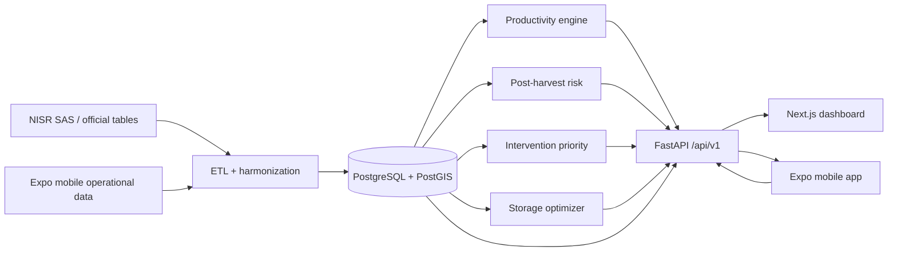

# Cropmatics Rwanda

**Crop Intelligence from Data to Action.**

A full-stack agricultural decision-intelligence platform for the
**[NISR 2026 Big Data Hackathon — Track 1: Agricultural Productivity](https://statistics.gov.rw/about/hackathon/2026-hackathon-competition)**. Cropmatics Rwanda combines
agricultural informatics, statistical analysis, machine learning, geospatial
intelligence and optimization to turn official agricultural statistics,
geospatial information and operational field data into actionable insights for
farmers, cooperatives and agricultural decision-makers.

> Results describe **associations** and **priorities for investigation** — not
> proven causal effects. See [MODEL_INTERPRETATION_POLICY](docs/MODEL_INTERPRETATION_POLICY.md).

## Why it exists

Rwanda has rich agricultural statistics, but raw data do not automatically tell
planners where productivity gaps are greatest, which observed factors track with
them, where to investigate first, or how upcoming harvests should be coordinated
with storage. Cropmatics turns that data into reviewable action.

## Architecture



Official statistics, external open data and voluntary app data are kept in
separate layers and never merged at respondent level.

## Stack

| Layer | Stack |
|---|---|
| Web | Next.js (App Router) + React + TypeScript + Tailwind + TanStack Query |
| Mobile | React Native + Expo + Expo Router + SQLite (offline-first) + TanStack Query |
| Backend | Python 3.11 + FastAPI + Pydantic + SQLAlchemy 2 + Alembic |
| Database | PostgreSQL + PostGIS |
| ML | pandas, scikit-learn; SHAP; OR-Tools |
| Deployment | Vercel + Render/Fly + Neon/Supabase + Expo EAS |

## Repository layout

```text
apps/web              Next.js planner dashboard
apps/mobile           Expo farmer/field-officer app (offline-first)
services/api          FastAPI service (routers, models, services, analytics, optimization)
ml                    productivity gap, yield model, risk, priority, storage optimization
data                  raw | external | interim | processed | dictionaries | source_registry | dev_fixtures
scripts               data pipeline + db/dev/deployment helpers
docs                  audit, architecture, policy, and reference documents
infra                 infrastructure notes
```

## Datasets

NISR SAS worksheet extracts for 2022–2026 live under `data/raw/nisr/sas/`.
Unique source workbooks are organized by year and release in `workbooks/`
subfolders; owner-supplied workbooks remain untracked, while the extracted CSVs
and their manifest are versioned for a reproducible Docker build. The separate
curated 2025B original is retained in the 2025B workbook folder for provenance.
The 2025B derived pack remains under `data/raw/cropmatics_real_data_2024_2026/`;
MINAGRI inputs are under `data/raw/external/minagri/`. Neither unreviewed SAS
sheets nor operational app records are presented as official analytical values.
Synthetic demo records are isolated in `data/dev_fixtures/`.

See [05_DATASET_CATALOG](docs/05_DATASET_CATALOG.md) and
[DATA_PROVENANCE](docs/DATA_PROVENANCE.md).

## Status

| Area | State |
|---|---|
| Data layer + pipeline | Functional; 14 productivity periods, with narrower coverage for other indicators and unmapped source sheets |
| Reference dictionaries | 30 districts, 17 crop categories |
| Backend analytics and optimization | Implemented; verify current production readiness before a demo |
| ML modules | Gap, priority, risk and optimizer implemented; forecast output is withheld without sufficient validation |
| Priority engine | Methodology **2.0.1**: two named planning purposes; a candidate above its benchmark is *ineligible* for productivity support rather than LOW-scoring; the reference population is stated and stable under a district inspection |
| Web app | Deployed dashboard, crop, map and analysis routes; check the live build and API readiness before a demo |
| Mobile app | Expo app with offline registration and sync; APK/network verification remains device-specific |
| Database migrations | Implemented; production readiness must still be checked |
| Auth/RBAC, notifications, reports export | ⚠️ Partial / scaffolded |
| Deployment | Web on Vercel and API on Render; see live readiness before a demo |

As checked on 2026-10-15, `GET /api/v1/health/readiness` reports `status: ready`
with dataset `0.2.0-646a72d53cd349df` and 14 published periods, and
`python scripts/verify_production.py` passes 12/12 required endpoints. The same
run resolves the API host from the system resolver and from two public resolvers,
those probes did not reproduce the reported browser DNS failure. They do not
establish the cause on the affected user's network. The script names the failing layer
(`dns_failure` / `tls_failure` / `timeout` / `connection_closed` / `http_error`).

Note that the checks above describe the **deployed** service. The intervention
priority engine in this working tree is methodology **2.0.1** (productivity-support
eligibility; see [11_INTERVENTION_ENGINE](docs/11_INTERVENTION_ENGINE.md)) and is
not live until the API is redeployed.

Latest local repairs: [FORECAST_INTEGRATION_REPAIR_REPORT](docs/FORECAST_INTEGRATION_REPAIR_REPORT.md).
Forecast filters, mobile failure states and Responses tool continuation are implemented locally;
this does not imply a new validated forecast, a production deployment or a device-tested APK.

Full details: [REPOSITORY_REFINEMENT_REPORT](docs/REPOSITORY_REFINEMENT_REPORT.md).
Dashboard work (this pass): [DASHBOARD_REFINEMENT_REPORT](docs/DASHBOARD_REFINEMENT_REPORT.md),
[DASHBOARD_IMPLEMENTATION_PROGRESS](docs/DASHBOARD_IMPLEMENTATION_PROGRESS.md),
[DATA_TO_UI_MATRIX](docs/DATA_TO_UI_MATRIX.md),
[FEATURE_DATA_COVERAGE](docs/FEATURE_DATA_COVERAGE.md).

### Dashboard pages

| Page | What it shows |
|---|---|
| `/dashboard` | National overview: Python KPIs, Rwanda choropleth, priority table, trends, gap heatmap |
| `/productivity` | Productivity intelligence: benchmark strategies, ranking, factor associations, model panel |
| `/interventions` | Intervention planner with adjustable transparent weights and scenario comparison |
| `/post-harvest` | Loss by crop, use composition, risk classification |
| `/storage` | Verified cold-chain context + clearly-marked OR-Tools scenario demo |
| `/maps` | District choropleth explorer |
| `/reports` | CSV exports generated by Python |
| `/data-explorer` | Search, filter and download every processed dataset |
| `/transparency` | Sources, coverage, algorithms, models, limitations, AI usage |
| `/assistant` | Grounded Q&A over validated analytics |
| `/yield-intelligence` | Yield workspaces and forecast status; no forecast is shown without qualifying evidence |
| `/markets` | Market data-status screen; verified price observations are not yet loaded |
| `/settings` | Application settings |

The web interface never computes an official analytical value: filters requery
the Python API, and the frontend only renders what the API returns.

## Getting started

Prerequisites: Node 20+, pnpm 9+, Python 3.11+, and (optionally) Docker for Postgres/PostGIS.

```bash
# 1. Environment
cp .env.example .env         # then edit secrets

# 2. JavaScript workspaces (web + mobile)
pnpm install

# 3. API virtualenv
make install-api             # creates services/api/.venv and installs deps

# 4. Build analytical tables from versioned official extracts
make data                    # uses services/api/.venv; rebuilds data/processed/
```

### Run

```bash
make api                     # FastAPI on http://localhost:8000
make web                     # Next.js on http://localhost:3000
make mobile                  # Expo dev server
```

Entry files: `apps/web/app/page.tsx` redirects to `/dashboard`;
`services/api/app/main.py` creates the FastAPI app;
`apps/mobile/app/index.tsx` is the Expo home screen; and
`scripts/data/run_all.py` starts the reproducible data build. Use `make dev`
to start the local API and web together, or `make api`, `make web`, and
`make mobile` separately. `scripts/dev.sh status` reports local services.

### Database

```bash
make db-up                   # PostGIS via docker compose
make migrate                 # apply Alembic migrations
make db-init                 # or create tables directly from models (dev)
```

The API reads `DATABASE_URL` from the environment (`.env` locally; a secret
environment variable on Render). Do not commit credentials. Confirm a live
connection and the correct dataset version at
`/api/v1/health/readiness`; `database: connected` with `status: not_ready`
means the connection works but the analytical database still needs attention.

### Share the mobile app (QR / link install)

The app reaches other phones through a shared QR code or link, not the Play Store:

```bash
./scripts/build-apk.sh       # EAS Build -> APK; API = this machine's LAN IP
./scripts/build-apk.sh --api https://api.example.com/api/v1   # deployed API
```

Requires a free Expo account (`npm i -g eas-cli && eas login`). The script bakes
the API URL and install-page URL into the APK; when the build finishes EAS hosts
the .apk at a public link. The in-app **Profile → Share app** screen shows the
QR + link to forward, and the web app exposes **/install** — a landing page with
the QR code, install steps and which API the build talks to. Put `/install` on
the big screen at a demo: attendees scan it and install.

### Data pipeline

```bash
make data           # validate + normalize + build processed tables
make data-validate  # validation report only
make migrate        # apply the canonical schema (Alembic)
make load           # upsert processed tables into the canonical PostgreSQL tables
make load-dry       # report exactly what a load would change, writing nothing
make bootstrap      # deploy step: migrate, load only if the version changed, verify
make bootstrap-dry  # show what the deploy step would do, writing nothing
```

The loader is idempotent: re-running it reports rows as *unchanged* instead of
duplicating them, records a `dataset_version` and one `data_ingestion_run` per
target table, and never deletes. `scripts/data/load_database.py` is kept as an
alias for backwards compatibility.

**PostgreSQL is the production analytical authority.** `CANONICAL_DATA_MODE`
decides which layer answers a read: `required` (production default — the
canonical database must serve it), `preferred` (database first, explicit file
fallback), or `file` (development only). The deploy step and CI are documented in
[`docs/P0_DATABASE_AUTHORITY.md`](docs/P0_DATABASE_AUTHORITY.md), which also
classifies the storage decision for every data domain.

### ML

```bash
make ml             # baseline yield model -> ml/reports/ model card
```

### Quality

```bash
make lint           # web + mobile + Python (ruff)
make typecheck      # web + mobile
make test           # API + ML pytest
```

## Documentation

Start at [DOCUMENTATION_INDEX.md](DOCUMENTATION_INDEX.md). Key documents:
audit ([00](docs/00_REPOSITORY_AUDIT.md)), architecture
([03](docs/03_SYSTEM_ARCHITECTURE.md), [04](docs/04_DATA_ARCHITECTURE.md)), rename
record ([PROJECT_RENAME_REPORT](docs/PROJECT_RENAME_REPORT.md)),
API ([07](docs/07_API_ARCHITECTURE.md)), ML
([10](docs/10_ML_METHODOLOGY.md)), and the interpretation policy
([MODEL_INTERPRETATION_POLICY](docs/MODEL_INTERPRETATION_POLICY.md)).

## Data policy

- Official NISR/MINAGRI statistics and voluntary app data are kept separate.
- Respondent-level NISR microdata is **not** redistributed.
- Missing values are `null`; capacity is never invented.
- Synthetic fixtures are test-only and labelled `SYNTHETIC`.

## Data coverage (2022A–2026B)

The canonical district productivity panel covers **14 published periods**
(2022A–2026B), 30 districts and 17 crops (6,156 rows); 2026 Season C has not been
published. District practice/irrigation/erosion and post-harvest observations
cover 2024A–2026B; the legacy single-release factor tables cover 2025 Season B
only. A value the source did not publish stays `null` everywhere — missing is
never `0`.

PostgreSQL is the production authority. A deployment serves the built dataset
only when its content-addressed version matches the image; otherwise analytical
reads return a structured `503 DATASET_OUT_OF_SYNC` rather than stale figures.
See [docs/P0_DATABASE_AUTHORITY.md](docs/P0_DATABASE_AUTHORITY.md),
[docs/FEATURE_DATA_COVERAGE.md](docs/FEATURE_DATA_COVERAGE.md) and
[docs/17_DEPLOYMENT.md](docs/17_DEPLOYMENT.md) (the pre-deploy bootstrap and the
dashboard checklist).

## License / provenance

See [DATA_LICENSE_AND_PROVENANCE.md](DATA_LICENSE_AND_PROVENANCE.md) and
[docs/DATA_PROVENANCE.md](docs/DATA_PROVENANCE.md).

