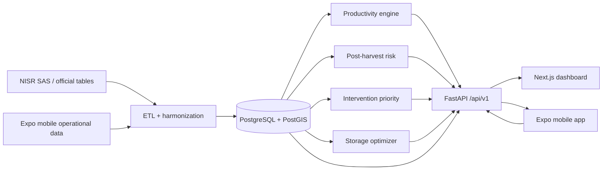

# Cropmatics Rwanda

**Crop Intelligence from Data to Action.**

A full-stack agricultural decision-intelligence platform for the **NISR 2026 Big
Data Hackathon — Track 1: Agricultural Productivity**. Cropmatics Rwanda combines
agricultural informatics, statistical analysis, machine learning, geospatial
intelligence and optimization to turn official agricultural statistics,
geospatial information and operational field data into actionable insights for
farmers, cooperatives and agricultural decision-makers.

> Results describe **associations** and **priorities for investigation** — not
> proven causal effects. See [MODEL_INTERPRETATION_POLICY](docs/MODEL_INTERPRETATION_POLICY.md).

## Why it exists

Rwanda has rich agricultural statistics, but raw data do not automatically tell
planners where productivity gaps are greatest, which observed factors track with
them, where to investigate first, or how upcoming harvests should be coordinated
with storage. Cropmatics turns that data into reviewable action.

## Architecture



Official statistics, external open data and voluntary app data are kept in
separate layers and never merged at respondent level.

## Stack

| Layer | Stack |
|---|---|
| Web | Next.js (App Router) + React + TypeScript + Tailwind + TanStack Query |
| Mobile | React Native + Expo + Expo Router + SQLite (offline-first) + TanStack Query |
| Backend | Python 3.11 + FastAPI + Pydantic + SQLAlchemy 2 + Alembic |
| Database | PostgreSQL + PostGIS |
| ML | pandas, scikit-learn; SHAP; OR-Tools |
| Deployment | Vercel + Render/Fly + Neon/Supabase + Expo EAS |

## Repository layout

```text
apps/web              Next.js planner dashboard
apps/mobile           Expo farmer/field-officer app (offline-first)
services/api          FastAPI service (routers, models, services, analytics, optimization)
ml                    productivity gap, yield model, risk, priority, storage optimization
data                  raw | external | interim | processed | dictionaries | source_registry | dev_fixtures
scripts               data pipeline + db/dev/deployment helpers
docs                  audit, architecture, policy, and reference documents
infra                 infrastructure notes
```

## Datasets

Real NISR/MINAGRI-derived data for 2024–2026 lives under
`data/raw/cropmatics_real_data_2024_2026/`, including the original NISR Season B
workbook (`raw_official/`). District × crop productivity and district
input/practice tables are the analytical core; national trends provide context.
Synthetic demo records are isolated in `data/dev_fixtures/` and clearly labelled.

See [05_DATASET_CATALOG](docs/05_DATASET_CATALOG.md) and
[DATA_PROVENANCE](docs/DATA_PROVENANCE.md).

## Status

| Area | State |
|---|---|
| Data layer + pipeline | ✅ Working (validate → normalize → build) |
| Reference dictionaries | ✅ 30 districts, 17 crop categories |
| Backend skeleton + analytics/optimization endpoints | ✅ Working (DB-backed auth/harvest pending DB) |
| ML modules + tests | ✅ Working (gap, priority, risk, metrics, optimizer) |
| Web app | ✅ Dashboard shell; 10 working pages + 3 coming-soon (see docs/DASHBOARD_IMPLEMENTATION_PROGRESS.md) |
| Mobile app | ✅ Starts; offline harvest registration + sync queue + refreshed dashboard/wizard |
| Database migrations | ⚠️ Alembic configured; first revision not yet generated |
| Auth/RBAC, notifications, reports export | ⚠️ Partial / scaffolded |
| Deployment | ⚠️ Documented, not provisioned |

Full details: [REPOSITORY_REFINEMENT_REPORT](docs/REPOSITORY_REFINEMENT_REPORT.md).
Dashboard work (this pass): [DASHBOARD_REFINEMENT_REPORT](docs/DASHBOARD_REFINEMENT_REPORT.md),
[DASHBOARD_IMPLEMENTATION_PROGRESS](docs/DASHBOARD_IMPLEMENTATION_PROGRESS.md),
[DATA_TO_UI_MATRIX](docs/DATA_TO_UI_MATRIX.md),
[FEATURE_DATA_COVERAGE](docs/FEATURE_DATA_COVERAGE.md).

### Dashboard pages

| Page | What it shows |
|---|---|
| `/dashboard` | National overview: Python KPIs, Rwanda choropleth, priority table, trends, gap heatmap |
| `/productivity` | Productivity intelligence: benchmark strategies, ranking, factor associations, model panel |
| `/interventions` | Intervention planner with adjustable transparent weights and scenario comparison |
| `/post-harvest` | Loss by crop, use composition, risk classification |
| `/storage` | Verified cold-chain context + clearly-marked OR-Tools scenario demo |
| `/maps` | District choropleth explorer |
| `/reports` | CSV exports generated by Python |
| `/data-explorer` | Search, filter and download every processed dataset |
| `/transparency` | Sources, coverage, algorithms, models, limitations, AI usage |
| `/assistant` | Grounded Q&A over validated analytics |
| `/yield-intelligence`, `/markets`, `/settings` | Professional "coming in next module" screens |

The web interface never computes an official analytical value: filters requery
the Python API, and the frontend only renders what the API returns.

## Getting started

Prerequisites: Node 20+, pnpm 9+, Python 3.11+, and (optionally) Docker for Postgres/PostGIS.

```bash
# 1. Environment
cp .env.example .env         # then edit secrets

# 2. JavaScript workspaces (web + mobile)
pnpm install

# 3. API virtualenv
make install-api             # creates services/api/.venv and installs deps

# 4. Build analytical tables from raw official data
make data                    # -> data/processed/training_district_crop.csv
```

### Run

```bash
make api                     # FastAPI on http://localhost:8000
make web                     # Next.js on http://localhost:3000
make mobile                  # Expo dev server
```

### Database

```bash
make db-up                   # PostGIS via docker compose
make migrate                 # apply Alembic migrations
make db-init                 # or create tables directly from models (dev)
```

### Share the mobile app (QR / link install)

The app reaches other phones through a shared QR code or link, not the Play Store:

```bash
./scripts/build-apk.sh       # EAS Build -> APK; API = this machine's LAN IP
./scripts/build-apk.sh --api https://api.example.com/api/v1   # deployed API
```

Requires a free Expo account (`npm i -g eas-cli && eas login`). The script bakes
the API URL and install-page URL into the APK; when the build finishes EAS hosts
the .apk at a public link. The in-app **Profile → Share app** screen shows the
QR + link to forward, and the web app exposes **/install** — a landing page with
the QR code, install steps and which API the build talks to. Put `/install` on
the big screen at a demo: attendees scan it and install.

### Data pipeline

```bash
make data           # validate + normalize + build processed tables
make data-validate  # validation report only
make migrate        # apply the canonical schema (Alembic)
make load           # upsert processed tables into the canonical PostgreSQL tables
make load-dry       # report exactly what a load would change, writing nothing
make bootstrap      # deploy step: migrate, load only if the version changed, verify
make bootstrap-dry  # show what the deploy step would do, writing nothing
```

The loader is idempotent: re-running it reports rows as *unchanged* instead of
duplicating them, records a `dataset_version` and one `data_ingestion_run` per
target table, and never deletes. `scripts/data/load_database.py` is kept as an
alias for backwards compatibility.

**PostgreSQL is the production analytical authority.** `CANONICAL_DATA_MODE`
decides which layer answers a read: `required` (production default — the
canonical database must serve it), `preferred` (database first, explicit file
fallback), or `file` (development only). The deploy step and CI are documented in
[`docs/P0_DATABASE_AUTHORITY.md`](docs/P0_DATABASE_AUTHORITY.md), which also
classifies the storage decision for every data domain.

### ML

```bash
make ml             # baseline yield model -> ml/reports/ model card
```

### Quality

```bash
make lint           # web + mobile + Python (ruff)
make typecheck      # web + mobile
make test           # API + ML pytest
```

## Documentation

Start at [DOCUMENTATION_INDEX.md](DOCUMENTATION_INDEX.md). Key documents:
audit ([00](docs/00_REPOSITORY_AUDIT.md)), architecture
([03](docs/03_SYSTEM_ARCHITECTURE.md), [04](docs/04_DATA_ARCHITECTURE.md)), rename
record ([PROJECT_RENAME_REPORT](docs/PROJECT_RENAME_REPORT.md)),
API ([07](docs/07_API_ARCHITECTURE.md)), ML
([10](docs/10_ML_METHODOLOGY.md)), and the interpretation policy
([MODEL_INTERPRETATION_POLICY](docs/MODEL_INTERPRETATION_POLICY.md)).

## Data policy

- Official NISR/MINAGRI statistics and voluntary app data are kept separate.
- Respondent-level NISR microdata is **not** redistributed.
- Missing values are `null`; capacity is never invented.
- Synthetic fixtures are test-only and labelled `SYNTHETIC`.

## License / provenance

See [DATA_LICENSE_AND_PROVENANCE.md](DATA_LICENSE_AND_PROVENANCE.md) and
[docs/DATA_PROVENANCE.md](docs/DATA_PROVENANCE.md).

