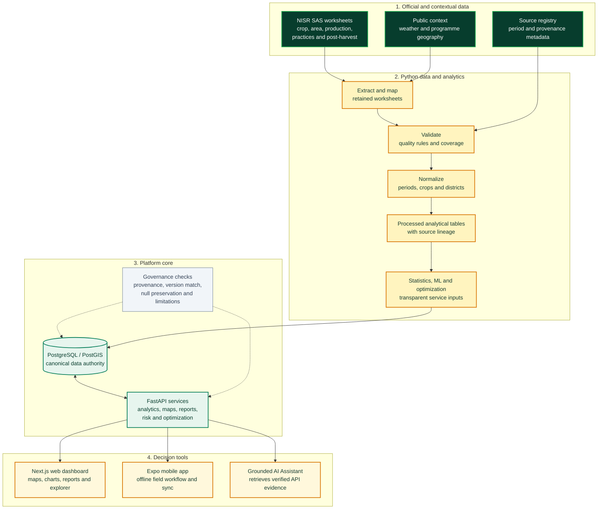

# Cropmatics

**Crop Intelligence from Data to Action.**

Cropmatics is Team DataSprout's agricultural decision-intelligence platform for
the NISR 2026 Track 1 challenge. It turns official Rwanda crop statistics into
traceable views for farmers, agricultural planners, researchers and
policymakers: compare crop productivity, investigate district gaps, understand
reported practices, plan interventions and register field harvests offline.

[Web dashboard](https://cropsmatics-web.vercel.app/dashboard) |
[API documentation](https://cropsmatics-api.onrender.com/docs) |
[Data and methods](docs/DATA_AND_METHODS.md) |
[Architecture](docs/ARCHITECTURE.md) |
[User guide](docs/USER_GUIDE.md) |
[Project status](docs/PROJECT_STATUS.md)

## Team DataSprout

| Team member | Institution | Role | Contribution |
|---|---|---|---|
| **Joyeuse Niwemufasha** | UR-CST | Data validation and analysis | Reviews NISR worksheet meaning, checks data quality and coverage, supports indicator definitions and analytical interpretation. |
| **Ndacyayisaba Lambert** | UR-CST | Platform engineering | Designs and integrates the data pipeline, database, FastAPI services, web dashboard, mobile workflow, deployment and user-facing decision tools. |

The team combines statistical care with a working product: every official
number is processed through the data pipeline and served through the API before
it reaches a chart, map, report or grounded assistant answer.

## The Challenge We Address

Agricultural evidence is valuable but difficult to use when it is spread across
workbook releases, crop tables, district observations and separate practice
indicators. Cropmatics gives users one explainable path from published data to
an action that can be investigated. It does not turn an association into a
causal claim, and it does not fill missing official values with invented
numbers.

## What You Can Do

| Workflow | Application |
|---|---|
| Explore crop performance across available periods | Dashboard, Crops, Productivity, Maps |
| Compare productivity shortfalls and transparent planning priorities | Interventions |
| Create assumption-based plans, separate from observed statistics | Yield Intelligence: Planning |
| Explore reported production use and verified storage-program context | Post-Harvest, Storage |
| Inspect sources, coverage and analytical datasets | Data Explorer, Data & Models |
| Ask questions grounded in retrieved analytical evidence | AI Assistant |
| Register harvests offline | Expo mobile app with authenticated sync; physical-device verification remains |

**Status:** release candidate with a maintained production verification path.
The current deployment, dataset identity and remaining evidence are recorded in
[Project Status](docs/PROJECT_STATUS.md).
The repository does not treat a stale commit, cached deployment or an old
dataset hash as proof of a current release; check the linked workflow and the
read-only production smoke gate for the revision being submitted.

For the NISR 2026 submission, the required public GitHub link, deployed app,
README, runnable scripts and source/data disclosure are represented here. The
maximum-three-minute screen recording remains a team-owned submission artifact;
current requirements and limitations are summarized in [Project Status](docs/PROJECT_STATUS.md).

## Data And Interpretation

- The district crop productivity panel contains 14 published periods from
  2022A through 2026B. Coverage varies by crop and indicator.
- Multi-period practice and post-harvest observations are distinct from the
  legacy 2025B factor extracts. Not every worksheet is mapped into analytics.
- Official statistics and voluntary mobile records remain separate.
- Priorities identify candidates for investigation, not proven causal effects.
- Manual plans use user assumptions. They are not official statistics or
  validated model forecasts; model output stays withheld when validation fails.
- Missing capacity and absent price data stay unavailable, never invented.

Versioned worksheet extracts are under `data/raw/nisr/sas/`. Owner-provided
workbooks are generally untracked; the curated official 2025B original is
retained for provenance. The legacy `data/raw/derived_source_extracts_2024_2026/`
directory is a derived compatibility pack, not an original NISR release. Its
manifest, row-level source fields and `09_source_registry.csv` identify the
upstream workbook/table and official URLs. Do not edit raw sources. Read [Data
and Methods](docs/DATA_AND_METHODS.md) for the full source trail, coverage,
formulas, quality notes and interpretation rules.

The numbered `01–05` files in that compatibility directory are intentionally
2025B archive extracts. The complete period-aware system is built from the
release-organized SAS tables in `data/raw/nisr/sas/` and the canonical processed
panel in `data/processed/crop_productivity.csv`, which covers `2022A–2026B`.

## Architecture



### What the flow means

1. **Data sources:** official NISR SAS worksheets are retained and catalogued;
   contextual sources are clearly labelled as context rather than official crop
   statistics.
2. **Python analytical layer:** extraction, validation, geography/crop
   normalization and calculations happen before visualization. Missing values
   remain missing, and every processed table carries provenance.
3. **Platform core:** PostgreSQL/PostGIS is the canonical production authority;
   FastAPI exposes typed analytical results, maps, reports, risk and planning
   services. Dataset-version checks block inconsistent reads.
4. **Decision tools:** the web dashboard and mobile app consume API responses.
   The AI Assistant retrieves evidence from the same API and withholds answers
   when the published data cannot support them.

Python computes analytical values. Clients visualize API responses. PostgreSQL
is the production analytical authority; explicit file mode supports development.
Dataset-version checks prevent silent reads from an out-of-sync deployment.

| Directory | Responsibility |
|---|---|
| `apps/web` | Next.js, React, TanStack Query, maps and charts |
| `apps/mobile` | Expo, React Native, SQLite and offline queue |
| `services/api` | FastAPI, services, repositories and Alembic migrations |
| `scripts/data` | Deterministic extraction, validation, build and database load |
| `ml` | Statistical models, validation and optimization |
| `data` | Sources, dictionaries, registries and generated outputs |
| `docs` | Core architecture, data methods, user guide and current project status |

## Local Setup

Requirements: Node 20+, pnpm 9, Python 3.11+, and Docker if running local
PostgreSQL/PostGIS. Run from the repository root:

```bash
cp .env.example .env
pnpm install --frozen-lockfile
npm --prefix apps/mobile ci
make install-api
make data
```

Edit `.env` privately before starting services. For a local database:

```bash
make db-up
make migrate
make load
make dev
```

The web app runs at `http://localhost:3000` and the API at
`http://localhost:8000`. Separate commands are `make api` and `make web`.
`bash scripts/dev.sh status` shows local service status. The commands above are
the maintained local setup path; never run migrations or loaders against
production unintentionally.

### Mobile With The Hosted API

Mobile is intentionally outside the pnpm workspace and uses its own npm lockfile:

```bash
cd apps/mobile
npm ci
EXPO_PUBLIC_API_BASE_URL=https://cropsmatics-api.onrender.com/api/v1 npx expo start --clear --tunnel
```

To submit a shareable Android APK build with the hosted backend configured in
the existing `release-apk` profile, run the repository helper from the
repository root. Do not run `eas build` directly inside `apps/mobile`: this
checkout has a historical trailing space in its folder name, so the helper
stages the mobile project at a clean temporary path and avoids EAS's
`spawn git ENOENT` and `path.relative()` failures:

```bash
bash scripts/build-apk.sh \
  --profile release-apk \
  --api "https://cropsmatics-api.onrender.com/api/v1" \
  --web "https://cropsmatics-web.vercel.app/install"
```

The helper validates the local `git` and `eas` executables before submitting.
For the current demo, the verified APK is published in the GitHub Release
`mobile-demo-2026-10-25`. Set that release URL as the production value of
`NEXT_PUBLIC_INSTALL_APK_URL`, then redeploy. The stable download URL is:

```text
https://cropsmatics-web.vercel.app/install/apk
```

Android still requires the user to open the downloaded APK and approve the
installation; a browser cannot silently install an APK. A successful build
still needs physical-device
verification. Do not use the local-backend development profile for an APK
intended for remote users.

## Demo Videos

The web-dashboard and mobile-app recordings are available in the shared
[Google Drive demo folder](https://drive.google.com/drive/folders/1Mr0XbSWsq0B1BI4xcghQ9eQG1IY6zxMN?usp=sharing).
The folder may continue processing the uploads while they are being added.
GitHub also stores the original recordings as a fallback:
[mobile app demo](demo/mobile-app-demo.mp4) and
[web dashboard demo](demo/web-dashboard-demo.mp4).

## Quality checks

```bash
make lint
make typecheck
make test
make scientific-validation
pnpm --filter cropmatics-web test
npm --prefix apps/mobile test
NEXT_PUBLIC_API_BASE_URL=https://cropsmatics-api.onrender.com/api/v1 pnpm --filter cropmatics-web build
(cd apps/web && npx playwright test --config=playwright.config.ts)
```

The repository quality gates cover the API, data pipeline, ML, web and mobile
packages. Current verified results and remaining external checks are kept in
[Project Status](docs/PROJECT_STATUS.md). Never point database tests or loaders
at production.

Entrypoints: `services/api/app/main.py`, `apps/web/app/page.tsx`,
`apps/mobile/app/index.tsx`, and `scripts/data/run_all.py`.
Check `/api/v1/health/readiness` for current backend/database readiness.

## Documentation Index

This is the complete maintained documentation set. Historical audits, submission
drafts and temporary deployment notes are intentionally not tracked.

| Document | Purpose |
|---|---|
| `README.md` | Project overview, architecture flow, setup, quality checks, team and data rights |
| [`docs/ARCHITECTURE.md`](docs/ARCHITECTURE.md) | Runtime and data-request architecture, boundaries and guardrails |
| [`docs/DATA_AND_METHODS.md`](docs/DATA_AND_METHODS.md) | Official sources, processing, formulas, coverage, limitations and provenance |
| [`docs/USER_GUIDE.md`](docs/USER_GUIDE.md) | Web and mobile workflows and how to read unavailable data |
| [`docs/PROJECT_STATUS.md`](docs/PROJECT_STATUS.md) | Current verified state, known limitations and release checklist |

This repository does not grant additional redistribution rights over
third-party datasets.
