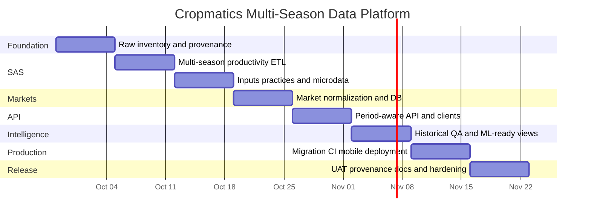

# Cropmatics Data Platform Expansion Plan: Multi-Season SAS, Microdata, and Market Prices

## Executive summary

Cropmatics is structurally ready for the next phase, but the data layer needs one deliberate refactor before more intelligence features are built.

The repository already has a sound separation between immutable raw data, processed analytical files, dictionaries, provenance metadata, a FastAPI service, SQLAlchemy models, Alembic migrations, ML code, web/mobile clients, and a deterministic `scripts/data` pipeline. The present bottleneck is that the production data path is still architecturally centered on **2025 Season B district data**, even though a much richer multi-season source set has now been added. The current `common.py` names 2025B district files explicitly; `validate_raw.py` actually rejects district-level periods other than `2025B`; and the main district crop/factor/post-harvest builders each read a single source file. fileciteturn16file0 fileciteturn17file0 fileciteturn18file0 fileciteturn19file0

The newest repository work is on the `mobile-intelligence-v2-local` branch rather than being cleanly integrated into the canonical raw-data layout. That branch now contains `Cropmatics_SAS_Full_Raw_Extraction`, with extracted table folders for the 2024 annual SAS, 2025 annual SAS, 2026 Season A, 2026 Season B, plus a `manifest.csv` that records workbook, sheet, used range, row count, column count and CSV path. fileciteturn13file0 fileciteturn14file0 The manifest confirms the extraction is substantially more complete than the existing 2025B-derived package. fileciteturn15file0

The four source workbooks in the current project workspace are:

| Workbook | Workspace size | Sheets found | Period coverage |
|---|---:|---:|---|
| `SAS 2024_Annual Tables.xlsx` | 345,341 bytes | 79 | 2024A, 2024B, 2024C |
| `SAS 2025_Annual Tables.xlsx` | 388,616 bytes | 80 | 2025A, 2025B, 2025C |
| `Tables_2026 Season A.xlsx` | 186,219 bytes | 35 | 2026A |
| `Tables_2026 Season B.xlsx` | 185,811 bytes | 33 | 2026B |

These names and approximate published sizes match NISR's official releases. NISR says the 2024 annual SAS covers Seasons A, B and C and publishes the 2024 workbook; the 2025 annual SAS similarly covers all three seasons; and the current 2026 page contains Season A and Season B releases, with the Season B workbook last updated on September 22, 2026. citeturn3search9turn3search4turn3search1turn3search0

The target production period dimension should therefore be exactly:

```text
2024A
2024B
2024C
2025A
2025B
2025C
2026A
2026B
```

As of September 27, 2026, Cropmatics should **not invent `2026C`**: NISR's 2026 catalogue currently lists Season A and Season B, not Season C. citeturn3search3turn3search11

The most important implementation sequence is:

1. **Merge/re-home the newly extracted SAS assets into a canonical raw-source structure and create a source catalogue with hashes.**
2. **Replace the hard-coded 2025B assumptions with an explicit period/table mapping layer.**
3. **Normalize district × crop production, harvested area, cultivated area and yield for all eight available periods.**
4. **Normalize input/practice, irrigation, erosion and post-harvest tables over the same period dimension where available.**
5. **Treat NISR respondent microdata as a separate restricted raw layer, deriving only documented aggregates/public price observations from it.**
6. **Create a provider-neutral `market_price_observation` pipeline capable of ingesting NISR selling-price data, MINAGRI/e-Soko exports, FEWS NET and later WFP DataBridges without changing the application schema.**
7. **Move the database load from destructive staging-table replacement toward typed canonical tables plus idempotent upsert.**
8. **Make period availability and market prices first-class FastAPI resources.**

NISR microdata is particularly valuable: the 2024 production files include district, crop, quantity sold, market where the crop was sold, and `s2q28`, “selling price per kilogram (Rwf/Kg).” citeturn4search1turn4search0 The official 2025 catalogue likewise contains Season A/B/C production, screening, agricultural-practice and fertilizer/pesticide files. citeturn4search13turn4search10 This can provide **historical farmer selling-price observations** even before a live e-Soko feed is secured.

For current market prices, MINAGRI confirms that e-Soko was established as an agricultural market-pricing information system providing prices for agricultural products. citeturn7search0 No stable, documented public e-Soko bulk API was identified in this audit, so Cropmatics should support official e-Soko CSV/manual exports rather than build production infrastructure around scraping. FEWS NET is the strongest immediately automatable complementary source: its official REST API exposes `marketpricefacts`, supports CSV, date filters, Rwanda/country filtering, and price types including Retail, Wholesale and Producer. citeturn5search0 WFP DataBridges should remain an optional provider because external users need credentials/API access. citeturn4search2

The recommended result after this eight-week program is not merely “more CSVs.” It is a stable longitudinal data platform:

```text
                         SOURCE LAYER
 ┌──────────────────────────────────────────────────────────────┐
 │ NISR SAS workbooks     NISR microdata      Market providers │
 │ 2024A–2026B            2024/2025           e-Soko / FEWS    │
 └────────────────────────────┬─────────────────────────────────┘
                              │
                       immutable raw files
                       + hashes + provenance
                              │
                              ▼
                    NORMALIZATION LAYER
 ┌──────────────────────────────────────────────────────────────┐
 │ periods │ districts │ crops │ productivity │ practices      │
 │ markets │ prices    │ sources │ QA flags │ lineage         │
 └────────────────────────────┬─────────────────────────────────┘
                              │
                              ▼
                         PostgreSQL
                              │
           ┌──────────────────┼──────────────────┐
           ▼                  ▼                  ▼
        FastAPI              ML              Exports
           │
      ┌────┴────┐
      ▼         ▼
     Web      Mobile
```

The repository is [Lambert-01/cropsmatics-](https://github.com/Lambert-01/cropsmatics-). The central recommendation is to make **`period_code`, source provenance, geography code and crop code part of the canonical data contract**, rather than adding each new season as another one-off CSV.

## Evidence base and assumptions

### Repository state

The repository already has the right high-level architecture for this work: raw/interim/processed data directories, dictionaries and source registries, Python ETL scripts, an API service, Alembic, SQLAlchemy models and ML pipelines. The existing Makefile exposes `make data`, `make data-validate`, `make load`, `make migrate`, API tests, data tests and ML tests, which gives this refactor a good automation point. fileciteturn36file0

The current ETL contract, however, is still explicitly tied to the original data pack:

```python
RAW_PACK = RAW_DIR / "cropmatics_real_data_2024_2026"

RAW_FILES = {
    "district_crop_productivity":
        "01_district_crop_productivity_2025B.csv",
    "district_factors":
        "02_district_productivity_factors_2025B.csv",
    ...
}
```

and its provenance identifiers similarly identify the district source as 2025B. fileciteturn16file0

More critically:

```python
DISTRICT_RELEASE = (2025, "B")
```

is enforced in `validate_raw.py`; a district dataset containing another period is currently considered an error. fileciteturn17file0 That must be removed before the newly extracted 2024–2026 district tables can become first-class data.

The existing PostgreSQL loader also uses:

```python
df.to_sql(table, engine, if_exists="replace", index=False)
```

for staging datasets. That is acceptable for an early-development cache but should not become the canonical historical-store strategy because it destroys/recreates staging table contents instead of maintaining typed, indexed, migration-controlled tables. fileciteturn22file0

The API already has a useful `ProductivityMetric` model containing year, season, district, crop, cultivated area, harvested area, production and yield, so the proposed `crop_productivity` schema is an evolution of existing concepts rather than a different architecture. fileciteturn26file0 The current `MarketPrice`, by contrast, stores only crop, district, date and `price_rwf_per_kg`; it has no market, price type, original unit, original currency/value, commodity raw name or provider-record identifier. fileciteturn25file0

There is also currently no market router registered in `api/v1/router.py`, although the application has a market database model. fileciteturn34file0

### Assumptions

This plan uses the following explicit assumptions rather than silently inventing details:

| Question | Assumption |
|---|---|
| Database | PostgreSQL, because the repo's loader and configuration currently target PostgreSQL; no special schema namespace is assumed. fileciteturn22file0turn35file0 |
| New-data branch | `mobile-intelligence-v2-local` is treated as the most complete visible data branch and should be merged/cherry-picked into the production branch after review. |
| Raw files | Source files are immutable. Corrections belong in mapping/configuration and processed outputs, never overwriting official originals. |
| Workbook authority | Workbook filename + explicit table mapping outrank free-text sheet titles where titles contain typos. |
| District codes | Existing `data/dictionaries/districts.csv` remains the canonical code map. |
| Crop codes | Existing crop dictionary and alias mechanism remain authoritative and are expanded, not replaced. |
| Microdata privacy | Raw respondent/plot identifiers are not served publicly. Only approved derived observations or aggregates leave the restricted raw layer. |
| Market units | No price is converted to `RWF/kg` unless the source unit and conversion factor are known. |
| Missing price source | Missing market/provider metadata causes quarantine or `UNSPECIFIED`; the ETL must never infer a market from a filename alone. |
| 2026C | Unavailable until officially published by NISR. citeturn3search3 |
| CHIRPS | Kept as a separate climate domain; it should not be mixed into SAS raw directories. The official CHIRPS archive currently exposes monthly Africa GeoTIFFs including 2024–2026 files. citeturn5search1 |

A notable data-quality requirement emerged from direct inspection of the official workbooks: title text cannot safely be the sole period detector. For example, the 2024 workbook's `Table 39` is labelled as another Season B seed-source table where its sequence is the Season C counterpart, and `Table 60` says **2023 Season C** despite belonging to the 2024 annual release and sitting between the 2024A and 2024B/2024C pesticide tables. These anomalies should remain visible as `source_title_raw`, while the normalized period comes from a reviewed table mapping. NISR's official annual release confirms that the 2024 workbook is the annual 2024 A/B/C source. citeturn3search9

## Data inventory and destination map

### Data currently found

The workspace contains the four original SAS Excel files listed below, and the GitHub branch contains their extracted table representation. NISR independently confirms the official workbook names and coverage. citeturn3search9turn3search4turn3search1turn3search0

| Current location | File or family | Size / count | Format | Inferred period(s) | Inferred domain | Important missing metadata |
|---|---|---:|---|---|---|---|
| Workspace | `SAS 2024_Annual Tables.xlsx` | 345,341 B; 79 sheets | XLSX | 2024A/B/C | production, yield, area, seeds, fertilizer, pesticides, practices, irrigation, erosion, production use | SHA-256 sidecar, source URL, retrieved date, license/access metadata |
| Workspace | `SAS 2025_Annual Tables.xlsx` | 388,616 B; 80 sheets | XLSX | 2025A/B/C | same broad SAS domains | same |
| Workspace | `Tables_2026 Season A.xlsx` | 186,219 B; 35 sheets | XLSX | 2026A | same broad SAS domains | same |
| Workspace | `Tables_2026 Season B.xlsx` | 185,811 B; 33 sheets | XLSX | 2026B | same broad SAS domains | same |
| GitHub branch | `Cropmatics_SAS_Full_Raw_Extraction/manifest.csv` | 21,847 B | CSV | 2024A–2026B | extraction metadata | domain, normalized period, source URL, checksum per extracted table |
| GitHub branch | `.../SAS_2024_Annual/Table 0.csv`–`Table 78.csv` | 79 files | CSV | 2024A/B/C | full annual SAS extraction | explicit domain/period mapping |
| GitHub branch | `.../SAS_2025_Annual/Contents.csv` + `Table 0.csv`–`Table 78.csv` | 80 files | CSV | 2025A/B/C | full annual SAS extraction | explicit domain/period mapping |
| GitHub branch | `.../SAS_2026_Season_A/Table 1.csv`–`Table 35.csv` | 35 files | CSV | 2026A | SAS | explicit table semantics |
| GitHub branch | `.../SAS_2026_Season_B/Table 1.csv`–`Table 33.csv` | 33 files | CSV | 2026B | SAS | explicit table semantics |

The branch manifest itself records `source_workbook`, `folder`, `sheet_name`, used range, row count, column count and extracted CSV path, which is exactly the right foundation for a proper ingestion catalogue. fileciteturn14file0 fileciteturn15file0 The extraction therefore contains **227 sheet/table CSVs** across the four releases, plus the manifest.

The old curated pack should remain temporarily for backward compatibility while the new pipeline is validated:

| Current path | File | Bytes | Domain / period | Future status |
|---|---|---:|---|---|
| `data/raw/cropmatics_real_data_2024_2026/` | `01_district_crop_productivity_2025B.csv` | 68,116 | productivity 2025B | superseded after parity test |
| same | `02_district_productivity_factors_2025B.csv` | 6,798 | inputs/practices 2025B | superseded |
| same | `03_irrigation_water_2025B.csv` | 3,075 | irrigation 2025B | superseded |
| same | `04_erosion_control_2025B.csv` | 3,872 | erosion 2025B | superseded |
| same | `05_crop_postharvest_use_2025B.csv` | 3,658 | production use/post-harvest 2025B | superseded |
| same | `06_national_crop_trends_2024_2026.csv` | 11,767 | national productivity trends | retain until rebuilt/parity-tested |
| same | `07_national_input_practice_trends_2024_2026.csv` | 719 | national practices | retain until rebuilt |
| same | `08_verified_cold_chain_context_2026.csv` | 1,704 | cold-chain context | retain |
| same | `09_source_registry.csv` | 2,067 | provenance | merge into canonical sources |
| same | `Cropmatics_Core_Real_Data_2024_2026.xlsx` | 62,204 | derived/curated workbook | archive as legacy derived asset |

Those files and sizes are present in the current branch's raw pack. fileciteturn37file0

The existing MINAGRI add-on contains:

| Current path | File | Bytes | Domain |
|---|---|---:|---|
| `data/raw/external/minagri/` | `10_national_postharvest_infrastructure_2024_2025.csv` | 1,052 | post-harvest infrastructure |
| same | `11_cold_chain_network_summary_2026.csv` | 1,569 | cold-chain |
| same | `Cropmatics_Official_Storage_Context_Addon.xlsx` | 6,387 | post-harvest/storage |
| same | `source_registry_additions.csv` | 744 | provenance |

These are already explicitly described in the code as national/program-level and should remain separate from district observations. fileciteturn38file0turn16file0

### Microdata and market-price inventory status

The project workspace available to this research did **not** contain downloadable NISR microdata files or an actual market-price CSV; the visible GitHub branch contains the SAS table extraction but no connector-visible `raw_downloads` directory. Because the request says to assume those files are being pushed, the implementation below treats them as incoming, discoverable datasets and deliberately does **not** invent file sizes or filenames that were not observed.

The expected NISR microdata families are nevertheless known from NISR's official catalogue. For 2024 the catalogue contains fertilizer/pesticide, agricultural-practice, production and screening files for Seasons A/B/C; the production data include crop, quantity harvested, quantity sold, market sold and selling price per kg. citeturn4search4turn4search1 The 2025 catalogue likewise includes fertilizer/pesticide, agricultural-practice, production and screening files for A/B/C. citeturn4search13turn4search10

### Canonical destination layout

Do not leave the new extraction as a permanent top-level repository directory. Move/copy it into the existing data architecture:

```text
data/
├── raw/
│   ├── nisr/
│   │   ├── sas/
│   │   │   ├── 2024/
│   │   │   │   └── annual/
│   │   │   │       ├── workbooks/
│   │   │   │       │   └── SAS 2024_Annual Tables.xlsx
│   │   │   │       └── tables/
│   │   │   │           ├── Table 0.csv
│   │   │   │           └── ...
│   │   │   ├── 2025/
│   │   │   │   └── annual/
│   │   │   │       ├── workbooks/
│   │   │   │       └── tables/
│   │   │   └── 2026/
│   │   │       ├── season_a/
│   │   │       │   ├── workbooks/
│   │   │       │   └── tables/
│   │   │       └── season_b/
│   │   │           ├── workbooks/
│   │   │           └── tables/
│   │   └── sas_microdata/
│   │       ├── 2024/
│   │       │   ├── season_a/
│   │       │   ├── season_b/
│   │       │   └── season_c/
│   │       └── 2025/
│   │           ├── season_a/
│   │           ├── season_b/
│   │           └── season_c/
│   ├── markets/
│   │   ├── esoko/
│   │   ├── fewsnet/
│   │   ├── wfp/
│   │   └── nisr_sas/
│   └── external/
│       └── minagri/
├── external/
│   └── chirps/
├── interim/
│   ├── source_catalog.csv
│   ├── sas_table_catalog.csv
│   ├── sas_productivity_long.csv
│   ├── market_price_quarantine.csv
│   └── validation_report.json
└── processed/
    ├── crop_productivity.csv
    ├── agricultural_practice_observation.csv
    ├── crop_postharvest_use.csv
    ├── market_price_observation.csv
    ├── sources.csv
    └── ...
```

The raw/source files should never be edited after acquisition. File moves should preferably be done with `git mv` for already-versioned files so history remains readable.

A useful first local inventory command is:

```bash
find data Cropmatics_SAS_Full_Raw_Extraction raw_downloads \
  -type f \
  \( -iname '*.csv' -o -iname '*.xlsx' -o -iname '*.xls' \
     -o -iname '*.json' -o -iname '*.geojson' -o -iname '*.tif' \
     -o -iname '*.gz' \) \
  -print0 2>/dev/null |
while IFS= read -r -d '' f; do
  printf '%s\t%s\n' "$(stat -f '%z' "$f" 2>/dev/null || stat -c '%s' "$f")" "$f"
done | sort -k2
```

Then create a reproducible metadata inventory, without changing the data:

```bash
python - <<'PY'
from pathlib import Path
import hashlib
import json

roots = [
    Path("data"),
    Path("Cropmatics_SAS_Full_Raw_Extraction"),
    Path("raw_downloads"),
]

allowed = {".csv", ".xlsx", ".xls", ".json", ".geojson", ".tif", ".gz"}
rows = []

for root in roots:
    if not root.exists():
        continue
    for path in root.rglob("*"):
        if not path.is_file() or path.suffix.lower() not in allowed:
            continue
        h = hashlib.sha256()
        with path.open("rb") as fh:
            for chunk in iter(lambda: fh.read(1024 * 1024), b""):
                h.update(chunk)
        rows.append({
            "path": str(path),
            "filename": path.name,
            "bytes": path.stat().st_size,
            "sha256": h.hexdigest(),
        })

print(json.dumps(rows, indent=2))
PY
```

That generated inventory should become the CI-checked source of truth instead of manually maintaining file lists.

## Normalized schemas and parsing strategy

### Destination schema by source family

| Source family | Canonical raw destination | Normalized output | Primary business key |
|---|---|---|---|
| SAS district crop tables | `data/raw/nisr/sas/...` | `crop_productivity` | `source_id + period_code + geography_code + crop_code` |
| SAS agricultural practices | same | `agricultural_practice_observation` | `source_id + period_code + geography_code + indicator_code` |
| SAS irrigation/water | same | same observation model or dedicated `irrigation_observation` | period + district + indicator |
| SAS erosion | same | same observation model or dedicated erosion table | period + district + indicator |
| SAS production use | same | `crop_postharvest_use` | source + period + crop + use category |
| SAS raw respondent production | `data/raw/nisr/sas_microdata/...` | private staging; derived market observations/aggregates only | source + respondent/plot internal key |
| e-Soko CSV | `data/raw/markets/esoko/` | `market_price_observation` | stable observation hash |
| FEWS NET CSV | `data/raw/markets/fewsnet/` | `market_price_observation` | stable observation hash |
| WFP export | `data/raw/markets/wfp/` | `market_price_observation` | stable observation hash |
| CHIRPS | `data/external/chirps/...` | later `rainfall_observation` | date + grid/district |
| source manifests | raw-side metadata + registry | `sources` | `source_id` |

### `crop_productivity`

Use a long, period-aware schema:

| Column | Type | Unit / rule |
|---|---|---|
| `period_code` | `varchar(5)` | `2024A`, `2025B`, etc. |
| `year` | `smallint` | 2024–2026 currently |
| `season` | `char(1)` | A/B/C |
| `geography_level` | text | `NATIONAL`, `PROVINCE`, `DISTRICT` |
| `geography_code` | text | canonical Cropmatics code |
| `province_code` | text nullable | dimension reference |
| `district_code` | text nullable | dimension reference |
| `crop_code` | text | canonical crop dictionary |
| `crop_name_raw` | text | untouched workbook label |
| `cultivated_area_ha` | numeric nullable | hectares |
| `harvested_area_ha` | numeric nullable | hectares |
| `production_mt` | numeric nullable | metric tonnes |
| `yield_kg_ha` | numeric nullable | kilograms/hectare |
| `source_id` | text | FK to source registry |
| `source_workbook` | text | original workbook |
| `source_sheet` | text | e.g. `Table 11` |
| `source_title_raw` | text | exact source title |
| `source_row` | integer nullable | raw row number |
| `period_override_reason` | text nullable | documents known title corrections |
| `processing_version` | text | pipeline release |
| `ingested_at` | timestamptz | lineage |

Do not convert SAS yields from kg/ha to t/ha in storage. Store the official canonical unit as kg/ha and convert only for presentation when desired. That matches the repository's current productivity model and current processed convention. fileciteturn26file0turn18file0

### `agricultural_practice_observation`

Instead of continually adding columns as each workbook introduces another practice, use a long indicator representation:

```text
period_code
year
season
geography_level
geography_code
indicator_code
indicator_name_raw
value
unit
population_scope
crop_code nullable
source_id
source_sheet
source_title_raw
```

Examples:

```text
2026B | RW-D07 | improved_seed_use | 20.9 | percent
2026B | RW-D07 | irrigation_use    | ...  | percent
2026B | RW-D07 | organic_fertilizer_use | ... | percent
```

Wide application-specific views can be generated later. This prevents schema migration every time a new SAS practice appears.

### `market_price_observation`

Market prices need more structure than the existing `MarketPrice` model. fileciteturn25file0

Recommended fields:

```text
observation_key        text
observation_date       date

commodity_code         text nullable
commodity_name_raw     text
variety                text nullable
quality_grade          text nullable

market_code            text nullable
market_name            text nullable
district_code          text nullable
province_code          text nullable

price_type             FARMGATE | PRODUCER | WHOLESALE | RETAIL |
                       ASSEMBLY | UNSPECIFIED

price_value_original   numeric
currency_original      text
unit_original          text

conversion_to_kg       numeric nullable
price_rwf_per_kg       numeric nullable

source_id              text
source_record_id       text nullable
source_file            text
source_row             integer nullable
source_url             text nullable
retrieved_at           timestamptz
ingested_at            timestamptz
```

Preserving both original and canonical values is crucial. A price such as “RWF per sack” must stay usable even if the sack-to-kilogram conversion is not documented; in that case `price_rwf_per_kg` remains null rather than being guessed.

NISR's 2024 microdata already defines selling price in RWF/kg, along with market and quantity sold, which makes it particularly clean for this schema. citeturn4search1turn4search0

FEWS NET's official API supports Retail, Wholesale, Producer and other price types and can return CSV at original/daily or aggregated schedules, so keeping `price_type`, source frequency and observation date explicit is necessary. citeturn5search0

### `sources`

Every analytical record should ultimately resolve to a source row:

```text
source_id
publisher
dataset_title
dataset_family
source_type
official
source_url
access_level
license
geographic_scope
period_start
period_end
published_at
retrieved_at
raw_path
sha256
notes
```

Example source IDs:

```text
NISR_SAS_2024_ANNUAL
NISR_SAS_2025_ANNUAL
NISR_SAS_2026A
NISR_SAS_2026B
NISR_SAS_2024_MICRODATA
NISR_SAS_2025_MICRODATA
MINAGRI_ESOKO
FEWSNET_MARKET_PRICES
WFP_DATABRIDGES
CHIRPS_V2
```

### Explicit SAS table mapping

The ingestion logic should **not determine period solely from sheet titles**. Use workbook + sheet as the primary mapping key.

The core productivity mapping verified from the supplied workbooks is:

| Release | Cultivated area | Harvested area | Yield | Production |
|---|---|---|---|---|
| 2024A | Table 10 | Table 13 | Table 16 | Table 21 |
| 2024B | Table 11 | Table 14 | Table 17 | Table 22 |
| 2024C | Table 12 | Table 15 | Table 18 | Table 23 |
| 2025A | Table 13 | Table 16 | Table 19 | Table 24 |
| 2025B | Table 14 | Table 17 | Table 20 | Table 25 |
| 2025C | Table 15 | Table 18 | Table 21 | Table 26 |
| 2026A | Table 11 | Table 12 | Table 13 | Table 15 |
| 2026B | Table 9 | Table 10 | Table 11 | Table 13 |

The 2026 Season B official release explicitly contains crop production/yield information and is the latest current SAS source. citeturn3search0

For 2024, other useful mappings include:

```text
Table 24 / 25 / 26   production use A/B/C
Table 30 / 31 / 32   seed use A/B/C
Table 40 / 41 / 42   organic fertilizer A/B/C
Table 43 / 44 / 45   inorganic fertilizer A/B/C
Table 55 / 56 / 57   pesticide use A/B/C
Table 61 / 62 / 63   agricultural practices A/B/C
Table 64 / 65 / 66   irrigation type A/B/C
Table 67 / 68 / 69   water source A/B/C
Table 70 / 71 / 72   anti-erosion measures A/B/C
Table 73 / 74 / 75   erosion degree A/B/C
```

Do **not** silently “fix” bad titles. A configuration entry should look like:

```python
TableSpec(
    workbook="SAS_2024_ANNUAL",
    sheet="Table 60",
    period_code="2024C",
    domain="pesticide_type",
    source_title_expected=None,
    period_override_reason=(
        "Workbook title says 2023 Season C; annual-release context "
        "and A/B/C table sequence identify this as the 2024C counterpart."
    ),
)
```

That gives Cropmatics traceable normalization rather than invisible data rewriting.

## Prioritized code changes and critical patches

### Highest-priority file changes

| Priority | File | Change | Why |
|---|---|---|---|
| P0 | Git branch/data layout | Merge newest data branch and relocate `Cropmatics_SAS_Full_Raw_Extraction` | New data must reach the production branch |
| P0 | `scripts/data/common.py` | Add canonical NISR/market paths, period helpers, output names | Removes 2025B path assumptions |
| P0 | new `scripts/data/sas_table_map.py` | Explicit workbook/sheet/domain/period registry | Handles title errors deterministically |
| P0 | new `scripts/data/catalog_raw.py` | Discover files, hash them and produce source inventory | Provenance and repeatability |
| P0 | new `scripts/data/ingest_sas_tables.py` | Parse CSV extraction/workbook sheets to long staging | Core 2024–2026 ingestion |
| P0 | `scripts/data/validate_raw.py` | Remove `DISTRICT_RELEASE=(2025,"B")` restriction | Current validator blocks new periods |
| P0 | `scripts/data/build_district_crop_dataset.py` | Build all eight periods | Historical core |
| P1 | factor/irrigation/erosion/postharvest builders | Iterate all mapped periods | Full SAS intelligence |
| P1 | new `scripts/data/ingest_market_prices.py` | Provider-neutral market normalization | Markets |
| P1 | `scripts/data/load_database.py` | Typed upsert rather than `replace` | Safe production loads |
| P1 | Alembic | Create `sources`, `crop_productivity`, `market_price_observation` | Canonical DB |
| P1 | `services/api/app/models/market.py` | Expand/replace shallow price model | Market metadata |
| P1 | `dataset_repository.py` | Multi-period + market loaders | API access |
| P1 | new `services/api/app/services/market_service.py` | Price filtering/latest/trends | Domain service |
| P1 | new `services/api/app/api/v1/markets.py` | Market endpoints | Public API |
| P1 | `api/v1/router.py` | Register market router | Exposure |
| P2 | dashboard/maps/analytics services | Accept `period_code` | Make existing UI historical |
| P2 | mobile map regression | Keep `.json` asset and test export | Prevent EAS regression |

The current mobile branch already contains **both** `rwanda_districts.geojson` and its same-content `.json` copy, and `RwandaMap.tsx` now requires the `.json` file. Therefore the GeoJSON-to-JSON correction is already implemented on this branch; the next action is a regression test, not another conversion. fileciteturn32file0turn33file0

### Patch for `common.py`

```diff
diff --git a/scripts/data/common.py b/scripts/data/common.py
@@
 ROOT = Path(__file__).resolve().parents[2]
 DATA_DIR = ROOT / "data"
 RAW_DIR = DATA_DIR / "raw"

-RAW_PACK = RAW_DIR / "cropmatics_real_data_2024_2026"
+RAW_NISR_DIR = RAW_DIR / "nisr"
+RAW_SAS_DIR = RAW_NISR_DIR / "sas"
+RAW_SAS_MICRODATA_DIR = RAW_NISR_DIR / "sas_microdata"
+RAW_MARKETS_DIR = RAW_DIR / "markets"
+RAW_LEGACY_DIR = RAW_DIR / "cropmatics_real_data_2024_2026"

 EXTERNAL_DIR = DATA_DIR / "external"
 INTERIM_DIR = DATA_DIR / "interim"
 PROCESSED_DIR = DATA_DIR / "processed"

-PIPELINE_VERSION = "0.1.0"
+PIPELINE_VERSION = "0.2.0"

+VALID_PERIODS = (
+    "2024A", "2024B", "2024C",
+    "2025A", "2025B", "2025C",
+    "2026A", "2026B",
+)
+
+def normalize_period(year: int | str, season: str) -> str:
+    year_i = int(year)
+    season_s = str(season).strip().upper()
+    code = f"{year_i}{season_s}"
+    if code not in VALID_PERIODS:
+        raise ValueError(f"unsupported/unpublished period: {code}")
+    return code
+
+PROCESSED_FILES.update({
+    "crop_productivity": "crop_productivity.csv",
+    "agricultural_practices": "agricultural_practice_observation.csv",
+    "market_prices": "market_price_observation.csv",
+    "sources": "sources.csv",
+})
```

Do not delete the current `RAW_FILES` immediately. Keep it as `LEGACY_RAW_FILES` for one release cycle so automated parity tests can compare new 2025B results with the already-live values. The existing path and provenance behavior are documented in `common.py`. fileciteturn16file0

### New SAS mapping module

```python
# scripts/data/sas_table_map.py
from __future__ import annotations

from dataclasses import dataclass


@dataclass(frozen=True)
class TableSpec:
    release: str
    sheet: str
    period_code: str
    domain: str
    metric: str | None = None
    unit: str | None = None
    geography_level: str = "DISTRICT"
    period_override_reason: str | None = None


PRODUCTIVITY_TABLES: tuple[TableSpec, ...] = (
    # 2024
    TableSpec("SAS_2024_ANNUAL", "Table 10", "2024A", "productivity", "cultivated_area", "ha"),
    TableSpec("SAS_2024_ANNUAL", "Table 11", "2024B", "productivity", "cultivated_area", "ha"),
    TableSpec("SAS_2024_ANNUAL", "Table 12", "2024C", "productivity", "cultivated_area", "ha"),
    TableSpec("SAS_2024_ANNUAL", "Table 13", "2024A", "productivity", "harvested_area", "ha"),
    TableSpec("SAS_2024_ANNUAL", "Table 14", "2024B", "productivity", "harvested_area", "ha"),
    TableSpec("SAS_2024_ANNUAL", "Table 15", "2024C", "productivity", "harvested_area", "ha"),
    TableSpec("SAS_2024_ANNUAL", "Table 16", "2024A", "productivity", "yield", "kg/ha"),
    TableSpec("SAS_2024_ANNUAL", "Table 17", "2024B", "productivity", "yield", "kg/ha"),
    TableSpec("SAS_2024_ANNUAL", "Table 18", "2024C", "productivity", "yield", "kg/ha"),
    TableSpec("SAS_2024_ANNUAL", "Table 21", "2024A", "productivity", "production", "mt"),
    TableSpec("SAS_2024_ANNUAL", "Table 22", "2024B", "productivity", "production", "mt"),
    TableSpec("SAS_2024_ANNUAL", "Table 23", "2024C", "productivity", "production", "mt"),

    # 2025
    TableSpec("SAS_2025_ANNUAL", "Table 13", "2025A", "productivity", "cultivated_area", "ha"),
    TableSpec("SAS_2025_ANNUAL", "Table 14", "2025B", "productivity", "cultivated_area", "ha"),
    TableSpec("SAS_2025_ANNUAL", "Table 15", "2025C", "productivity", "cultivated_area", "ha"),
    TableSpec("SAS_2025_ANNUAL", "Table 16", "2025A", "productivity", "harvested_area", "ha"),
    TableSpec("SAS_2025_ANNUAL", "Table 17", "2025B", "productivity", "harvested_area", "ha"),
    TableSpec("SAS_2025_ANNUAL", "Table 18", "2025C", "productivity", "harvested_area", "ha"),
    TableSpec("SAS_2025_ANNUAL", "Table 19", "2025A", "productivity", "yield", "kg/ha"),
    TableSpec("SAS_2025_ANNUAL", "Table 20", "2025B", "productivity", "yield", "kg/ha"),
    TableSpec("SAS_2025_ANNUAL", "Table 21", "2025C", "productivity", "yield", "kg/ha"),
    TableSpec("SAS_2025_ANNUAL", "Table 24", "2025A", "productivity", "production", "mt"),
    TableSpec("SAS_2025_ANNUAL", "Table 25", "2025B", "productivity", "production", "mt"),
    TableSpec("SAS_2025_ANNUAL", "Table 26", "2025C", "productivity", "production", "mt"),

    # 2026A
    TableSpec("SAS_2026A", "Table 11", "2026A", "productivity", "cultivated_area", "ha"),
    TableSpec("SAS_2026A", "Table 12", "2026A", "productivity", "harvested_area", "ha"),
    TableSpec("SAS_2026A", "Table 13", "2026A", "productivity", "yield", "kg/ha"),
    TableSpec("SAS_2026A", "Table 15", "2026A", "productivity", "production", "mt"),

    # 2026B
    TableSpec("SAS_2026B", "Table 9", "2026B", "productivity", "cultivated_area", "ha"),
    TableSpec("SAS_2026B", "Table 10", "2026B", "productivity", "harvested_area", "ha"),
    TableSpec("SAS_2026B", "Table 11", "2026B", "productivity", "yield", "kg/ha"),
    TableSpec("SAS_2026B", "Table 13", "2026B", "productivity", "production", "mt"),
)
```

Create equivalent mapping blocks for production use, seeds, fertilizers, pesticide use, irrigation and erosion. Those mappings should be code-reviewed as data contracts.

### Robust Excel/CSV table reader

Prefer the already-extracted raw CSV table when its SHA/manifest is valid because that makes builds deterministic and avoids Excel-engine differences. Keep workbook parsing as an extraction/reproducibility path:

```python
# scripts/data/io_sas.py
from pathlib import Path

import pandas as pd


def read_sheet_raw(workbook: Path, sheet_name: str) -> pd.DataFrame:
    """Read exactly what Excel contains; no inferred headers."""
    return pd.read_excel(
        workbook,
        sheet_name=sheet_name,
        header=None,
        dtype=object,
        engine="openpyxl",
    )


def read_extracted_table(csv_path: Path) -> pd.DataFrame:
    """Read extraction without changing source values."""
    return pd.read_csv(
        csv_path,
        header=None,
        dtype=object,
        keep_default_na=False,
        encoding="utf-8-sig",
    )
```

The existing extraction manifest already provides exact `sheet_name` and used range and should be used to verify workbook→CSV equivalence. fileciteturn15file0

### Remove the 2025B validator lock

```diff
diff --git a/scripts/data/validate_raw.py b/scripts/data/validate_raw.py
@@
 KNOWN_SEASONS = {"A", "B", "C"}
 PLAUSIBLE_YEARS = {2024, 2025, 2026}
-DISTRICT_RELEASE = (2025, "B")
+EXPECTED_PERIODS = {
+    "2024A", "2024B", "2024C",
+    "2025A", "2025B", "2025C",
+    "2026A", "2026B",
+}

-def _check_period(name, df, *, district_level=False):
+def _check_period(
+    name: str,
+    df: pd.DataFrame,
+    *,
+    allowed_periods: set[str] | None = None,
+) -> None:
@@
-    if district_level:
-        unexpected = [
-            p for p in observed
-            if p != f"{DISTRICT_RELEASE[0]}{DISTRICT_RELEASE[1]}"
-        ]
+    if allowed_periods is not None:
+        unexpected = sorted(set(observed) - allowed_periods)
         if unexpected:
             issue(
                 "error",
                 name,
-                f"district table contains non-district periods {unexpected}"
+                f"unexpected periods: {unexpected}; "
+                f"allowed={sorted(allowed_periods)}",
             )
```

Then:

```python
_check_period(
    "crop_productivity",
    df,
    allowed_periods=EXPECTED_PERIODS,
)
```

The current validator's single-release rule is precisely what prevents the historical district panel from passing. fileciteturn17file0

### Build all-period crop productivity

Refactor `build_district_crop_dataset.py` rather than creating eight parallel scripts:

```python
def main() -> int:
    metric_frames = []

    for spec in PRODUCTIVITY_TABLES:
        frame = parse_district_crop_metric(spec)
        metric_frames.append(frame)

    long_df = pd.concat(metric_frames, ignore_index=True)

    # One row per period x geography x crop, metrics in columns.
    df = (
        long_df.pivot_table(
            index=[
                "period_code",
                "year",
                "season",
                "district",
                "crop",
                "source_id",
            ],
            columns="metric",
            values="value",
            aggfunc="first",
        )
        .reset_index()
        .rename(columns={
            "cultivated_area": "cultivated_area_ha",
            "harvested_area": "harvested_area_ha",
            "production": "production_mt",
            "yield": "yield_kg_ha",
        })
    )

    # Existing dictionary merges remain here.
    ...
```

Retain the current district and crop-dictionary joins, provenance columns, null preservation and harvest-ratio QA logic. Those are useful parts of the existing builder. fileciteturn18file0

### Market-price ingestion

```python
# scripts/data/ingest_market_prices.py
from __future__ import annotations

import hashlib
from pathlib import Path

import pandas as pd

from scripts.data.common import RAW_MARKETS_DIR, PROCESSED_DIR


def stable_key(parts: list[object]) -> str:
    raw = "|".join("" if p is None else str(p).strip() for p in parts)
    return hashlib.sha256(raw.encode("utf-8")).hexdigest()


def normalize_price_type(value: object) -> str:
    text = str(value or "").strip().lower()
    mapping = {
        "farmgate": "FARMGATE",
        "farm gate": "FARMGATE",
        "producer": "PRODUCER",
        "wholesale": "WHOLESALE",
        "retail": "RETAIL",
        "assembly": "ASSEMBLY",
    }
    return mapping.get(text, "UNSPECIFIED")


def normalize_provider_file(
    path: Path,
    *,
    source_id: str,
    column_map: dict[str, str],
) -> pd.DataFrame:
    raw = pd.read_csv(path, dtype=str, encoding="utf-8-sig")

    renamed = raw.rename(columns=column_map)

    required = {
        "observation_date",
        "commodity_name_raw",
        "price_value_original",
    }
    missing = required - set(renamed.columns)
    if missing:
        raise ValueError(f"{path}: missing mapped columns {sorted(missing)}")

    out = renamed.copy()
    out["observation_date"] = pd.to_datetime(
        out["observation_date"], errors="raise"
    ).dt.date

    out["price_value_original"] = pd.to_numeric(
        out["price_value_original"], errors="coerce"
    )

    out["price_type"] = (
        out.get("price_type", pd.Series(index=out.index, dtype=object))
        .map(normalize_price_type)
    )

    out["source_id"] = source_id
    out["source_file"] = str(path)
    out["source_row"] = range(2, len(out) + 2)

    # Do not invent a kg conversion.
    if "conversion_to_kg" in out:
        factor = pd.to_numeric(out["conversion_to_kg"], errors="coerce")
        out["price_rwf_per_kg"] = (
            out["price_value_original"] / factor
        ).where(factor > 0)
    else:
        out["price_rwf_per_kg"] = pd.NA

    out["observation_key"] = [
        stable_key([
            source_id,
            r.observation_date,
            getattr(r, "market_name", None),
            r.commodity_name_raw,
            r.price_type,
            getattr(r, "price_value_original", None),
            getattr(r, "unit_original", None),
        ])
        for r in out.itertuples()
    ]
    return out


def main() -> None:
    # Source adapters/config should enumerate actual files found.
    ...
```

For FEWS NET, use an adapter matching the official API fields rather than a scraper. FEWS NET officially exposes `marketpricefacts.csv`, supports country, date, product and `price_type` filters, and unauthenticated requests can return public data. citeturn5search0

For WFP, leave the adapter disabled unless credentials exist; WFP's own tooling says external users need to obtain API credentials. citeturn4search2

### Patch the raw downloader rather than mixing download and transformation

The earlier `download_raw_datasets.py` should be moved under `scripts/data/` and should do only three things: download, preserve source bytes and register metadata.

A critical addition is:

```python
from hashlib import sha256
from pathlib import Path
from datetime import datetime, timezone
import json


def sha256_file(path: Path) -> str:
    h = sha256()
    with path.open("rb") as fh:
        for chunk in iter(lambda: fh.read(1024 * 1024), b""):
            h.update(chunk)
    return h.hexdigest()


def write_sidecar(
    path: Path,
    *,
    source_id: str,
    source_url: str,
    publisher: str,
) -> None:
    metadata = {
        "source_id": source_id,
        "publisher": publisher,
        "source_url": source_url,
        "filename": path.name,
        "bytes": path.stat().st_size,
        "sha256": sha256_file(path),
        "retrieved_at": datetime.now(timezone.utc).isoformat(),
    }
    path.with_suffix(path.suffix + ".source.json").write_text(
        json.dumps(metadata, indent=2) + "\n",
        encoding="utf-8",
    )
```

Source-specific output directories should become:

```python
OUTPUTS = {
    "fews": ROOT / "data/raw/markets/fewsnet",
    "esoko": ROOT / "data/raw/markets/esoko",
    "wfp": ROOT / "data/raw/markets/wfp",
    "chirps": ROOT / "data/external/chirps/v2",
    "nisr_cpi": ROOT / "data/raw/nisr/cpi",
}
```

CHIRPS should remain a climate raw source; its official archive exposes monthly Africa GeoTIFF files. citeturn5search1

### SQL DDL

A concrete PostgreSQL starting point:

```sql
CREATE TABLE sources (
    source_id           text PRIMARY KEY,
    publisher           text NOT NULL,
    dataset_title       text NOT NULL,
    dataset_family      text NOT NULL,
    source_type         text NOT NULL,
    official            boolean NOT NULL DEFAULT false,
    source_url          text,
    access_level        text NOT NULL DEFAULT 'PUBLIC',
    license             text,
    geographic_scope    text,
    period_start        date,
    period_end          date,
    published_at        date,
    retrieved_at        timestamptz,
    raw_path            text,
    sha256              char(64),
    notes               text,
    created_at          timestamptz NOT NULL DEFAULT now()
);


CREATE TABLE crop_productivity (
    id                   bigserial PRIMARY KEY,

    period_code          varchar(5) NOT NULL,
    year                 smallint NOT NULL,
    season               char(1) NOT NULL,

    geography_level      varchar(16) NOT NULL,
    geography_code       varchar(32) NOT NULL,
    province_code        varchar(32),
    district_code        varchar(32),

    crop_code            varchar(64) NOT NULL,
    crop_name_raw        text,

    cultivated_area_ha   numeric(18,4),
    harvested_area_ha    numeric(18,4),
    production_mt        numeric(18,4),
    yield_kg_ha          numeric(18,4),

    source_id            text NOT NULL REFERENCES sources(source_id),
    source_workbook      text,
    source_sheet         text,
    source_title_raw     text,
    source_row           integer,
    period_override_reason text,

    processing_version   varchar(32) NOT NULL,
    ingested_at          timestamptz NOT NULL DEFAULT now(),

    CONSTRAINT ck_crop_productivity_period
        CHECK (period_code ~ '^20[0-9]{2}[ABC]$'),

    CONSTRAINT ck_crop_productivity_season
        CHECK (season IN ('A', 'B', 'C')),

    CONSTRAINT ck_crop_productivity_nonnegative
        CHECK (
            COALESCE(cultivated_area_ha, 0) >= 0 AND
            COALESCE(harvested_area_ha, 0) >= 0 AND
            COALESCE(production_mt, 0) >= 0 AND
            COALESCE(yield_kg_ha, 0) >= 0
        ),

    CONSTRAINT uq_crop_productivity_observation
        UNIQUE (
            source_id,
            period_code,
            geography_level,
            geography_code,
            crop_code
        )
);

CREATE INDEX ix_crop_productivity_period_crop
    ON crop_productivity(period_code, crop_code);

CREATE INDEX ix_crop_productivity_district_period
    ON crop_productivity(district_code, period_code);


CREATE TABLE market_price_observation (
    id                     bigserial PRIMARY KEY,
    observation_key        char(64) NOT NULL UNIQUE,
    observation_date       date NOT NULL,

    commodity_code         varchar(64),
    commodity_name_raw     text NOT NULL,
    variety                text,
    quality_grade          text,

    market_code            varchar(64),
    market_name            text,
    district_code          varchar(32),
    province_code          varchar(32),

    price_type             varchar(16) NOT NULL DEFAULT 'UNSPECIFIED',

    price_value_original   numeric(18,4) NOT NULL,
    currency_original      varchar(8) NOT NULL,
    unit_original          text NOT NULL,

    conversion_to_kg       numeric(18,8),
    price_rwf_per_kg       numeric(18,4),

    source_id              text NOT NULL REFERENCES sources(source_id),
    source_record_id       text,
    source_file            text,
    source_row             integer,
    source_url             text,

    retrieved_at           timestamptz,
    ingested_at            timestamptz NOT NULL DEFAULT now(),

    CONSTRAINT ck_market_price_type CHECK (
        price_type IN (
            'FARMGATE',
            'PRODUCER',
            'WHOLESALE',
            'RETAIL',
            'ASSEMBLY',
            'UNSPECIFIED'
        )
    ),

    CONSTRAINT ck_market_price_positive
        CHECK (price_value_original >= 0),

    CONSTRAINT ck_market_price_canonical_positive
        CHECK (price_rwf_per_kg IS NULL OR price_rwf_per_kg >= 0)
);

CREATE INDEX ix_market_price_date_commodity
    ON market_price_observation(observation_date, commodity_code);

CREATE INDEX ix_market_price_market_date
    ON market_price_observation(market_code, observation_date);

CREATE INDEX ix_market_price_district_date
    ON market_price_observation(district_code, observation_date);
```

Create these through Alembic, not by manually executing production DDL. The repository already has `make migrate` wired to `alembic upgrade head`, and Alembic officially uses `upgrade head` to advance to the latest revision. fileciteturn36file0 citeturn8search8

### Replace destructive load with staging + upsert

Do not keep:

```python
if_exists="replace"
```

as the final historical load mechanism. fileciteturn22file0

A safe pattern is:

```python
from sqlalchemy import text

with engine.begin() as conn:
    frame.to_sql(
        "_load_crop_productivity",
        conn,
        if_exists="replace",
        index=False,
    )

    conn.execute(text("""
        INSERT INTO crop_productivity (
            period_code,
            year,
            season,
            geography_level,
            geography_code,
            province_code,
            district_code,
            crop_code,
            crop_name_raw,
            cultivated_area_ha,
            harvested_area_ha,
            production_mt,
            yield_kg_ha,
            source_id,
            source_workbook,
            source_sheet,
            source_title_raw,
            source_row,
            period_override_reason,
            processing_version
        )
        SELECT
            period_code,
            year,
            season,
            geography_level,
            geography_code,
            province_code,
            district_code,
            crop_code,
            crop_name_raw,
            cultivated_area_ha,
            harvested_area_ha,
            production_mt,
            yield_kg_ha,
            source_id,
            source_workbook,
            source_sheet,
            source_title_raw,
            source_row,
            period_override_reason,
            processing_version
        FROM _load_crop_productivity
        ON CONFLICT (
            source_id,
            period_code,
            geography_level,
            geography_code,
            crop_code
        )
        DO UPDATE SET
            cultivated_area_ha = EXCLUDED.cultivated_area_ha,
            harvested_area_ha = EXCLUDED.harvested_area_ha,
            production_mt = EXCLUDED.production_mt,
            yield_kg_ha = EXCLUDED.yield_kg_ha,
            source_title_raw = EXCLUDED.source_title_raw,
            processing_version = EXCLUDED.processing_version,
            ingested_at = now()
    """))

    conn.execute(text("DROP TABLE _load_crop_productivity"))
```

### API exposure

Add these API contracts:

```text
GET /api/v1/meta/periods

GET /api/v1/productivity
    ?period_code=2026B
    &crop_code=MAIZE
    &district_code=RW-...

GET /api/v1/productivity/trend
    ?crop_code=MAIZE
    &district_code=...
    &season=B

GET /api/v1/markets/prices
    ?commodity_code=...
    &district_code=...
    &price_type=RETAIL
    &date_from=2026-08-01
    &date_to=2026-09-27

GET /api/v1/markets/latest
    ?commodity_code=...
    &price_type=RETAIL
```

Add:

```python
# services/api/app/repositories/dataset_repository.py

def crop_productivity() -> pd.DataFrame:
    return _load("crop_productivity.csv")


def market_prices() -> pd.DataFrame:
    return _load("market_price_observation.csv")
```

and new:

```python
# services/api/app/api/v1/markets.py
from datetime import date

from fastapi import APIRouter, Query

from app.services.market_service import MarketService

router = APIRouter(prefix="/markets", tags=["markets"])


@router.get("/prices")
def list_prices(
    commodity_code: str | None = None,
    district_code: str | None = None,
    price_type: str | None = None,
    date_from: date | None = Query(default=None),
    date_to: date | None = Query(default=None),
):
    return MarketService().list_prices(
        commodity_code=commodity_code,
        district_code=district_code,
        price_type=price_type,
        date_from=date_from,
        date_to=date_to,
    )
```

Register it:

```diff
 from app.api.v1 import (
     analytics,
+    markets,
     ...
 )

 ...
+api_router.include_router(markets.router)
```

A dedicated market router is currently absent from the registered v1 API. fileciteturn34file0

## Validation, tests, API checks, and mobile export

The testing strategy should deliberately test the **data contract**, not just whether pandas produced a CSV.

### Parser unit tests

Create:

```text
scripts/tests/
├── test_source_catalog.py
├── test_period_codes.py
├── test_sas_table_map.py
├── test_sas_productivity_parser.py
├── test_sas_title_overrides.py
├── test_market_price_parser.py
├── test_microdata_adapter.py
└── test_pipeline_idempotence.py
```

The key assertions should be:

| Test | Acceptance |
|---|---|
| period normalization | accepts exactly current eight periods; rejects malformed codes and unpublished `2026C` |
| table-map uniqueness | no `(release, sheet, domain, metric)` duplicate |
| table-map coverage | every required productivity metric exists for all eight periods |
| known bad titles | 2024 `Table 39` and `Table 60` retain raw title but resolve through explicit override |
| workbook/extraction identity | sheet/table row/column counts agree with manifest |
| crop aliases | no unmapped production crop reaches canonical output |
| district aliases | no unknown district reaches canonical output |
| numeric rules | no negative area, production or yield |
| percentage rules | percentage indicators remain in 0–100 unless explicitly documented otherwise |
| key uniqueness | no duplicate productivity business keys |
| idempotence | two runs produce identical processed hashes |
| price units | no `RWF/kg` generated without verified conversion |
| market key | repeated source row generates same observation key |
| microdata privacy | IDs/segment/farmer identifiers absent from public processed outputs |

NISR's SAS covers all 30 districts, so district-level tables expected to have national coverage should explicitly test dictionary coverage against all 30 districts; however, absence of a crop in a district must remain null/no observation rather than being invented as zero. citeturn3search0turn4search9

Keep the useful existing yield-consistency check:

```text
production_mt × 1000 / harvested_area_ha ≈ yield_kg_ha
```

but treat discrepancies as data-quality warnings rather than rewriting official numbers, as the current validator already does. fileciteturn17file0

### 2025B backward-compatibility test

This is essential before removing the legacy pack.

```python
def test_2025b_new_pipeline_matches_legacy():
    legacy = load_legacy_2025b()
    new = load_new_productivity().query("period_code == '2025B'")

    joined = legacy.merge(
        new,
        on=["district_code", "crop_code"],
        suffixes=("_old", "_new"),
    )

    for metric in (
        "cultivated_area_ha",
        "harvested_area_ha",
        "production_mt",
        "yield_kg_ha",
    ):
        assert_metric_parity(joined, metric, tolerance=1e-6)
```

Only after that passes should the 2025B one-off source files become legacy/archive inputs.

### Microdata QA

Do not assume values such as `9999` are valid prices or missing-value sentinels merely by looking at numeric range. The NISR 2024 catalogue reports `s2q28` as a numeric field with range up to 9999; the correct treatment must come from the associated value labels/codebook, not from guesswork. citeturn4search0

The microdata pipeline should therefore produce:

```text
data/interim/microdata/
├── raw_schema_report.json
├── value_label_report.json
├── market_name_dictionary.csv
└── quarantine_unknown_codes.csv
```

and require an explicit mapping before a raw code becomes a production-facing district, crop or market.

### Market-price QA

For every price file:

```text
source_id is present
observation_date parses
commodity raw name is preserved
original price is numeric
currency is known
original unit is known
price_type is explicit or UNSPECIFIED
provider duplicates collapse by stable observation key
canonical RWF/kg is nullable
```

Provider-specific consistency checks should remain separate. A FEWS NET `Wholesale` record should not be silently equated to a NISR farmer selling price, for example. FEWS NET formally distinguishes price types, while NISR's field is the farmer-reported selling price per kilogram. citeturn5search0turn4search0

### Integration sequence

Run locally:

```bash
git checkout mobile-intelligence-v2-local

python3 -m venv services/api/.venv
services/api/.venv/bin/pip install \
  -r services/api/requirements.txt \
  -r services/api/requirements-dev.txt

python -m scripts.data.catalog_raw
python -m scripts.data.ingest_sas_tables
python -m scripts.data.validate_raw
python -m scripts.data.run_all

make test-data
make test-api
make test-ml
```

Then database:

```bash
make db-up
make migrate
python scripts/data/load_database.py
```

Verify periods:

```bash
curl "http://localhost:8000/api/v1/meta/periods"
```

Expected set:

```json
[
  "2024A",
  "2024B",
  "2024C",
  "2025A",
  "2025B",
  "2025C",
  "2026A",
  "2026B"
]
```

Check a productivity query:

```bash
curl \
  "http://localhost:8000/api/v1/productivity?period_code=2026B&crop_code=MAIZE"
```

Check market ingestion when a real source file exists:

```bash
curl \
  "http://localhost:8000/api/v1/markets/prices?price_type=RETAIL"
```

### Mobile production-bundle regression

The previous `.geojson` issue is already corrected on the current branch: both files exist and `RwandaMap.tsx` loads `.json`. fileciteturn32file0turn33file0

Turn that into a CI guard:

```bash
cmp \
  apps/mobile/assets/geodata/rwanda_districts.geojson \
  apps/mobile/assets/geodata/rwanda_districts.json
```

Then:

```bash
cd apps/mobile

npx expo export \
  --platform android \
  --output-dir /tmp/cropmatics-android-export
```

Expo documents `npx expo export --platform android` as the production JS/assets bundling check, and its CLI supports `--output-dir`. citeturn8search4turn8search5

A useful pre-EAS gate becomes:

```bash
npm run typecheck &&
npm run lint &&
npx expo export \
  --platform android \
  --output-dir /tmp/cropmatics-android-export
```

Do not submit a cloud build if this fails.

## Deployment and operations checklist

### Render backend

The backend configuration already reads `CORS_ORIGINS` as a comma-separated environment value and turns it into a list. fileciteturn35file0

Production should contain:

```text
CORS_ORIGINS=http://localhost:3000,http://127.0.0.1:3000,https://cropsmatics-web.vercel.app
```

and:

```text
ENVIRONMENT=production
DATABASE_URL=<production PostgreSQL/Neon URL>
```

Render recommends production configuration through environment variables and allows saving changes with an immediate redeploy. citeturn6search2

The recommended Render **pre-deploy command** is:

```bash
cd services/api && alembic upgrade head
```

If the Render root directory is already `services/api`, use simply:

```bash
alembic upgrade head
```

Render specifically recommends pre-deploy commands for database migrations. It also warns that pre-deploy runs on a separate instance and filesystem changes there are **not reflected in the deployed service**. Therefore do not run `make data` in a pre-deploy command expecting newly generated CSVs to appear in the running container. citeturn6search1

A better production flow is:

```text
CI / build:
    validate raw
    build processed assets
    run tests

Render pre-deploy:
    alembic upgrade head
    optional idempotent DB load/upsert

Render runtime:
    start FastAPI
```

For a DB-first architecture, the idempotent loader can be pre-deploy because its **database writes** persist even though the pre-deploy filesystem does not.

After deployment:

```bash
curl https://cropsmatics-api.onrender.com/api/v1/health
curl https://cropsmatics-api.onrender.com/api/v1/health/readiness

curl \
  "https://cropsmatics-api.onrender.com/api/v1/meta/periods"

curl \
  "https://cropsmatics-api.onrender.com/api/v1/productivity?period_code=2026B"
```

### Vercel web

Keep:

```text
NEXT_PUBLIC_API_BASE_URL=https://cropsmatics-api.onrender.com/api/v1
```

For a future explicit default period:

```text
NEXT_PUBLIC_DEFAULT_PERIOD=2026B
```

should be optional; preferably the web client should call `/meta/periods` and select the latest published period rather than hard-code it.

Vercel environment changes only affect new deployments, so after changing a production environment value you must redeploy. citeturn6search0turn6search7

Production deployment check:

```bash
cd apps/web
pnpm typecheck
pnpm lint
pnpm build
```

then either merge to the configured production branch or:

```bash
vercel --prod
```

Vercel documents production deployment through the production branch or `vercel --prod`. citeturn6search4

### EAS / Android

Production values should remain:

```text
EXPO_PUBLIC_API_BASE_URL=https://cropsmatics-api.onrender.com/api/v1
EXPO_PUBLIC_INSTALL_PAGE_URL=https://cropsmatics-web.vercel.app/install
```

Verify:

```bash
cd apps/mobile
eas env:list --environment production
```

Set/update if necessary:

```bash
eas env:set \
  --environment production \
  --name EXPO_PUBLIC_API_BASE_URL \
  --value https://cropsmatics-api.onrender.com/api/v1 \
  --visibility plaintext
```

Expo recommends explicitly associating a build profile with its environment, and `EXPO_PUBLIC_*` values are inlined into client code, so they must not contain secrets. citeturn5search3turn8search10

Before EAS:

```bash
npx expo export \
  --platform android \
  --output-dir /tmp/cropmatics-android-export
```

Then:

```bash
EAS_NO_VCS=1 \
EAS_PROJECT_ROOT="$(pwd)" \
npx eas-cli@latest build \
  --platform android \
  --profile release-apk
```

The `EAS_NO_VCS` workaround is only necessary while the local Git spawning issue remains; it should not become a permanent CI design.

### Alembic migration order

Use:

```bash
cd services/api

alembic revision \
  --autogenerate \
  -m "add multi-period productivity and market prices"
```

Review the generated migration manually, especially foreign keys and indexes, then:

```bash
alembic upgrade head
```

Then perform the idempotent data load.

For production rollback readiness, also test:

```bash
alembic downgrade -1
alembic upgrade head
```

against a disposable local/test database before deploying. Alembic's documented migration model uses `upgrade head` for the latest revision. citeturn8search8

## Eight-week delivery plan and code-generation prompts

The schedule below starts Monday, September 28, 2026. The effort estimate is approximately **53 person-days** of engineering/data work. This is an implementation estimate, not an elapsed-time promise; parallel work can reduce calendar pressure.



| Week | Priority deliverable | Effort | Acceptance criteria |
|---|---|---:|---|
| Sep 28–Oct 4 | Canonical raw layout + inventory + source catalogue | 6 pd | Every discovered CSV/XLS/XLSX has path, bytes, SHA-256, source/provider and status; new branch assets merged/re-homed; raw bytes unchanged |
| Oct 5–11 | Multi-season crop productivity | 8 pd | `crop_productivity` contains valid 2024A/B/C, 2025A/B/C, 2026A/B; 2025B parity test passes; no unexplained duplicate key |
| Oct 12–18 | Inputs/practices/post-harvest + microdata adapter | 7 pd | seed/fertilizer/pesticide/irrigation/erosion mappings work by period; microdata stays private; no raw respondent IDs in API-ready outputs |
| Oct 19–25 | Market schema + provider adapters | 8 pd | migration created; at least one real available price source loads end-to-end; original unit/value preserved; unknown units not fabricated into RWF/kg |
| Oct 26–Nov 1 | Period-aware FastAPI and repository layer | 7 pd | period endpoint returns eight periods; productivity filters by period/crop/district; market endpoint filters date/type/commodity; existing clients remain compatible |
| Nov 2–8 | Historical QA + analytical views | 6 pd | year-on-year same-season views reproducible; ML training source can consume historical panel; source lineage available for every row |
| Nov 9–15 | Production migration + CI + mobile | 6 pd | Alembic migration tested; Render deploy succeeds; Vercel succeeds; `expo export -p android` succeeds; EAS build gate green |
| Nov 16–22 | UAT, documentation, performance, rollback | 5 pd | source/provenance docs complete; API smoke suite green; rollback exercised; no placeholders caused by missing data that is already ingested |

### Definition of done for the data foundation

At the end of the sprint, this query should work without special-case code:

```sql
SELECT
    period_code,
    district_code,
    crop_code,
    cultivated_area_ha,
    harvested_area_ha,
    production_mt,
    yield_kg_ha,
    source_id
FROM crop_productivity
WHERE crop_code = 'MAIZE'
ORDER BY period_code, district_code;
```

and expose multiple official periods rather than only 2025B.

Likewise:

```sql
SELECT
    observation_date,
    commodity_code,
    market_name,
    district_code,
    price_type,
    price_value_original,
    currency_original,
    unit_original,
    price_rwf_per_kg,
    source_id
FROM market_price_observation
WHERE commodity_code = 'MAIZE'
ORDER BY observation_date DESC;
```

should work regardless of whether the rows originated from NISR, e-Soko, FEWS NET or a later WFP provider.

### One-line prompts for a code-generation assistant

Run these individually so each change stays reviewable rather than asking an agent to rewrite the entire system at once.

| Target | One-line implementation prompt |
|---|---|
| Raw inventory | **“Inspect the Cropmatics repo and implement `scripts/data/catalog_raw.py` to recursively inventory all raw CSV/XLS/XLSX/JSON/GeoJSON/TIFF files with path, bytes, SHA-256, inferred provider, retrieval metadata and validation status without modifying source files; add pytest tests.”** |
| Directory migration | **“Refactor Cropmatics raw paths into `data/raw/nisr/sas`, `data/raw/nisr/sas_microdata`, `data/raw/markets/{esoko,fewsnet,wfp,nisr_sas}`, preserving legacy paths for one compatibility release and using `git mv` instructions only.”** |
| Period utility | **“Update `scripts/data/common.py` with canonical period codes 2024A/B/C, 2025A/B/C, 2026A/B, a strict `normalize_period()` helper, new processed filenames and provider directories while retaining backward compatibility.”** |
| SAS map | **“Create `scripts/data/sas_table_map.py` using dataclass-based explicit workbook/sheet mappings for 2024A–2026B productivity, production-use, seeds, fertilizer, pesticides, irrigation, water and erosion tables; preserve raw titles and document known title overrides.”** |
| Excel parser | **“Implement `scripts/data/io_sas.py` and `scripts/data/ingest_sas_tables.py` to read manifest-listed extracted CSVs preferentially and XLSX sheets as fallback, preserve raw cells, convert mapped district/crop tables from wide to long, and emit lineage columns.”** |
| Productivity builder | **“Refactor `build_district_crop_dataset.py` so it combines cultivated area, harvested area, production and yield across all eight published periods into one canonical crop_productivity dataset keyed by period, geography and crop, preserving current dictionary joins and QA flags.”** |
| Validator | **“Refactor `scripts/data/validate_raw.py` to remove the 2025B-only DISTRICT_RELEASE rule and validate dataset-specific allowed periods, duplicate keys, district/crop dictionary coverage, percentage ranges, nonnegative metrics and source lineage for 2024A–2026B.”** |
| Factors | **“Refactor Cropmatics factor, irrigation, erosion and post-harvest builders to iterate explicit SAS period mappings and produce period-aware canonical outputs without imputing missing official values.”** |
| Microdata | **“Implement a restricted NISR SAS microdata adapter for 2024/2025 that preserves raw respondent files, reads provider codebooks, maps district/crop/market/selling-price fields, quarantines unknown codes and never exposes respondent or plot identifiers in public processed outputs.”** |
| Market ETL | **“Create `scripts/data/ingest_market_prices.py` with provider adapters for NISR-SAS, e-Soko CSV, FEWS NET and WFP exports; preserve original currency/unit/value, normalize price types, calculate RWF/kg only with verified conversion factors, generate stable observation hashes and quarantine malformed rows.”** |
| Source registry | **“Replace Cropmatics’ fragmented source registries with a canonical `sources.csv` builder containing publisher, dataset title, official flag, URL, access level, license, dates, raw path and SHA-256 while retaining the old source IDs through aliases.”** |
| Database | **“Create an Alembic migration adding typed `sources`, `crop_productivity` and `market_price_observation` tables with the constraints and indexes in the implementation plan, and update SQLAlchemy models accordingly.”** |
| DB loader | **“Refactor `scripts/data/load_database.py` from destructive `to_sql(if_exists='replace')` canonical loading to transactional staging plus PostgreSQL upsert keyed by stable business keys, with idempotence tests.”** |
| Period API | **“Add a FastAPI period metadata endpoint that derives available periods from canonical data and returns ordered period_code/year/season/latest flags without hard-coding 2025B.”** |
| Productivity API | **“Make Cropmatics productivity, analytics, maps and dashboard services accept `period_code` and optional same-season comparison filters while maintaining backward compatibility by defaulting to the latest available official period.”** |
| Markets API | **“Implement `market_service.py`, market Pydantic schemas and `/api/v1/markets/prices` plus `/api/v1/markets/latest`, register the router, and add tests for commodity/district/date/price-type filtering and source metadata.”** |
| Mobile geodata | **“Add a regression test ensuring `rwanda_districts.json` exists and matches the GeoJSON source bytes, ensure `RwandaMap.tsx` imports `.json`, and add an Android `npx expo export` smoke command to CI.”** |
| CI | **“Extend Cropmatics CI so every pull request runs raw-catalog validation, SAS parser tests, `make data`, deterministic-output hash checks, API tests, web/mobile typechecks and `npx expo export --platform android` before allowing deployment.”** |
| Deployment | **“Update Cropmatics deployment documentation with Render Alembic pre-deploy migration, CORS for cropsmatics-web.vercel.app, Vercel production API env, EAS production env, production smoke tests and rollback commands.”** |

### Primary source links used for the implementation

The authoritative source set for this phase should remain narrow:

- [Cropmatics GitHub repository](https://github.com/Lambert-01/cropsmatics-), whose current pipeline/model state is the basis for the patches above. fileciteturn16file0turn17file0turn22file0
- [NISR SAS 2024 Annual](https://www.statistics.gov.rw/statistical-publications/agriculture-environment/seasonal-agricultural-survey-2024-annual-report-2024), which publishes the official 2024 A/B/C workbook. citeturn3search9
- [NISR SAS 2025 Annual](https://www.alpha.statistics.gov.rw/data-sources/surveys/Seasonal-Agricultural-Survey/Seasonal-Agricultural-Survey/seasonal-agricultural-survey-2025-), which publishes the 2025 A/B/C annual workbook. citeturn3search4
- [NISR SAS 2026 Season A](https://statistics.gov.rw/statistical-publications/agriculture-environment/seasonal-agricultural-survey-season-2026). citeturn3search1
- [NISR SAS 2026 Season B](https://statistics.gov.rw/statistical-publications/agriculture-environment/seasonal-agricultural-survey-season-b-2026), the latest official SAS release found as of September 27, 2026. citeturn3search0
- [NISR SAS 2024 microdata](https://microdata.statistics.gov.rw/index.php/catalog/113/datafile/F3), including production, market and selling-price variables. citeturn4search1
- [NISR SAS 2025 microdata](https://microdata.statistics.gov.rw/index.php/catalog/124/datafile/F7), including the Season B production family and associated 2025 study. citeturn4search10
- [MINAGRI e-Soko description](https://www.minagri.gov.rw/updates/news-details/rwanda-hosts-the-4th-malabo-monpellier-forum-on-digitalization-agriculture), confirming e-Soko's role as an agricultural market-pricing system. citeturn7search0
- [FEWS NET API documentation](https://help.fews.net/fde/v3/fews-net-api), which documents its public market-price API, CSV extracts and price-type filtering. citeturn5search0
- [WFP DataBridges tooling](https://github.com/WFP-VAM/DataBridgesKnots/), whose official project documents market-price access and credential requirements. citeturn4search2
- [CHIRPS v2 Africa monthly archive](https://data.chc.ucsb.edu/products/CHIRPS-2.0/africa_monthly/tifs/), for the later climate pipeline. citeturn5search1

The decisive architectural change is therefore not another dashboard page. It is to make the currently working Cropmatics system **source-driven, period-aware and provider-neutral**: immutable official files at the bottom, explicit mappings and validations in the middle, canonical PostgreSQL records above them, and API/web/mobile consumers that no longer care whether the underlying observation originated in 2024A, 2025B or 2026B. That foundation unlocks Yield Intelligence, historical district comparisons, persistent yield-gap analysis and Markets without having to redesign the data layer again for every new season.