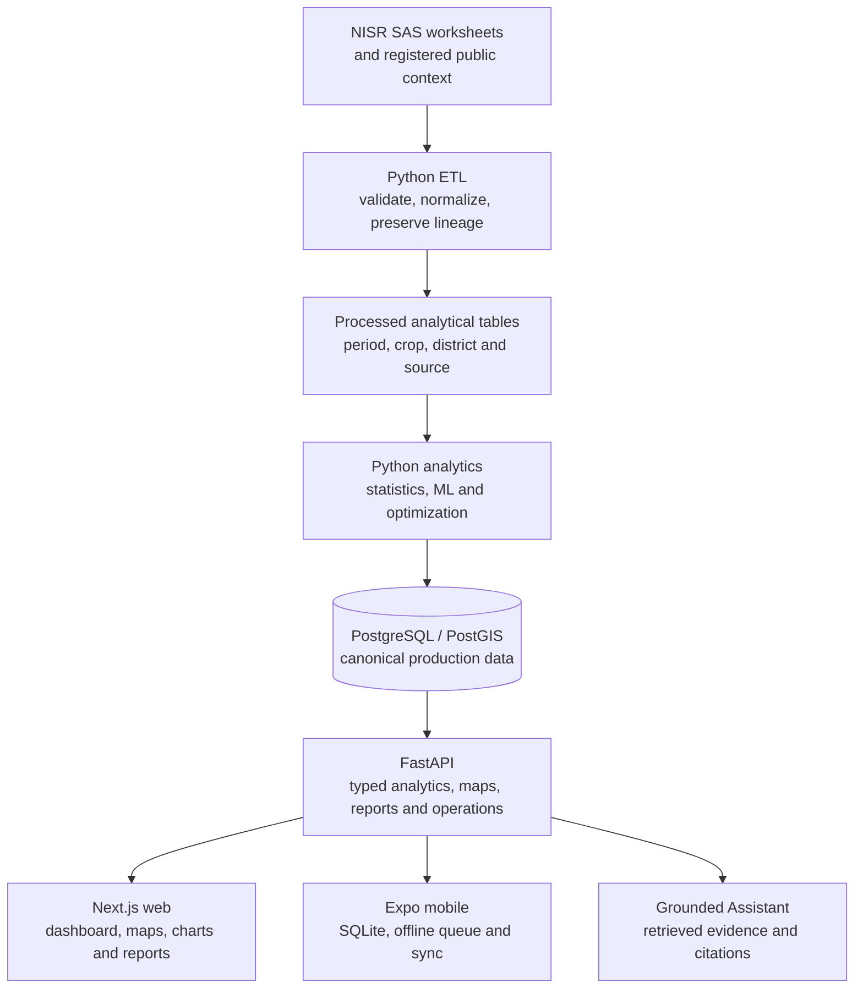

# Cropmatics Architecture

Cropmatics keeps analytical authority in Python and uses the web and mobile
clients as visualization and interaction layers.

## Main responsibilities

| Area | Responsibility |
|---|---|
| `scripts/data` | Deterministic extraction, validation, normalization and loading |
| `data` | Immutable sources, dictionaries, registries and generated outputs |
| `services/api` | FastAPI routes, repositories, analytical services and migrations |
| `ml` | Model evaluation, intervention scoring and storage optimization |
| `apps/web` | Next.js dashboard, maps, filters, reports and transparency views |
| `apps/mobile` | Expo navigation, SQLite offline records, sync and field workflows |

## Request flow

1. A user selects a period, crop, district or benchmark in the client.
2. TanStack Query requests the selection from FastAPI.
3. A service reads prepared data through a repository and applies the documented
   analytical method.
4. The response contains visualization-ready values, units, source, period and
   limitations.
5. The client renders the response and does not recalculate official metrics.

## Guardrails

- Dataset-version checks block reads from an out-of-sync canonical database.
- Missing values remain null or explicitly unavailable.
- District joins use canonical district codes rather than display names alone.
- The Assistant retrieves allowlisted read-only analytical tools and validates
  numbers, claims and citations before returning provider-written prose.
- API keys stay in backend environment variables and are never placed in web or
  mobile public variables.
- Mobile operational records remain separate from official national statistics.

## Hosted surfaces

- Web: `https://cropsmatics-web.vercel.app/dashboard`
- API: `https://cropsmatics-api.onrender.com/docs`
- Mobile installation: `https://cropsmatics-web.vercel.app/install/apk`

The current verification state, limitations and final release actions are in
[Project Status](PROJECT_STATUS.md).
